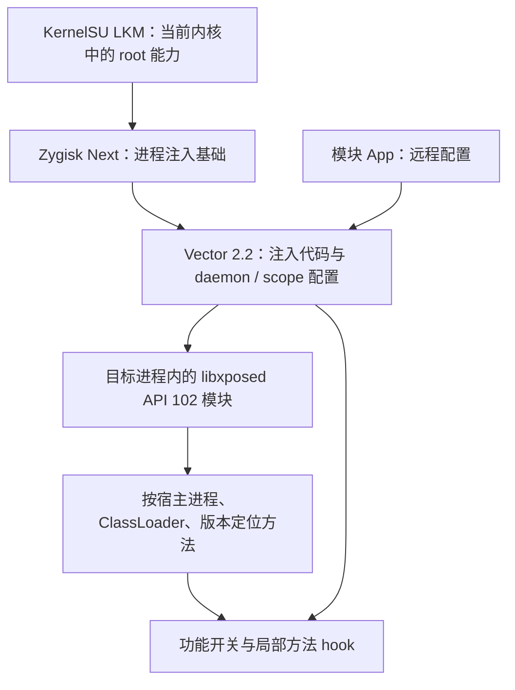

# OriginOS 7 / Vector 2.2 / 临时 root：本机 hook 方案研究

研究日期：2026-11-16。范围：本仓库现存源码、采集记录，以及固定提交的一手上游源码。
本轮未连接设备、未安装 APK、未修改 hook 业务代码，也未执行任何 root/框架恢复动作。

## 结论

推荐沿用 **KernelSU LKM 提供 root → Zygisk Next 提供注入 → Vector 2.2 提供 ART hook → libxposed API 102 模块实现功能** 的分层方案。临时 root 主要约束框架初始化和进程生命周期；模块进入宿主以后，Java hook 的编写方式无需另造一套“临时 root API”。已有 XHook 日志证明 Vector 2.2/API 102 在本机 Android 17 上曾成功加载并命中业务方法，但不能据此认定 OriginTweaks 已适配。[E1]、[E2]、[E3]

**目前适合推进的是应用进程内、按功能开关控制的窄范围 hook。现有 OriginTweaks 0.1.6 应作为待完善的工作副本，不能直接当整套可用方案。** 优先解决加载时序、类加载器、版本匹配与部分安装失败，再研究拖放功能；桌面/最近任务另设阶段，涉及 `system_server` 的外屏工作台暂留静态研究。依据是现存代码缺口、全部未验证的功能记录和设备红线，而不是仅凭“写了 try/catch”判断安全。[E4]、[E5]、[E6]

## 1. 本机基线与证据强度

这里的“最新系统”指仓库中最近的本机采样，**不是所有 vivo 最新机型/固件的通用兼容声明**。

| 项目 | 本轮能确认的内容 | 证据与限制 |
|---|---|---|
| 设备/系统快照 | V2545A / PD2545D；`PD2545D_A_17.1.13.20.W10`；系统构建 2026-11-06，SPL 2026-10-01 | 11-15 11:45 的 [MANIFEST.md](../../root/device-dump/pd2545-B-17.1.13.20/MANIFEST.md#L9)；本轮未实时复核 |
| 内核 | `6.12.58-android16-6-gdd6fd5c98918`；构建日期 2026-08-05 | 同一快照；8 月日期属于内核，不能当成系统构建日期 |
| root | 该快照记录 KernelSU v3.3.1 LKM、内存加载、AVB green / locked | 证明当时状态；不证明当前仍有 root |
| Vector / Zygisk Next | 留存模块属性为 Vector `2.2 / 3080 / 88f8e1fa`、Zygisk Next `1.5.3 / 880` | [Vector 属性](../../root/vector-softreboot/device/module_prop.txt)、[Zygisk Next 属性](../../root/vector-softreboot/device/znext_module_prop.txt) |
| 较晚运行证据 | 11-15 23:12，Vector 2.2/API 102；宿主 `com.twitter.android`；Android 17/API 37；随后有实际广告跳过记录 | [XHook 原始日志](../../xhook/notes/logcat-0.3.1-verified.txt#L1)，只能证明该时间窗口内的功能 |
| OriginTweaks | 源码版本 0.1.6；运行记录中九项功能均未验证 | [NOTES.md 功能矩阵](NOTES.md#L30)，不能把旧静态审计升级为真机验收 |
| 缺失材料 | 当前工作区没有 `originos/`、`root/.upstream/`、`_tmp_vector/`；没有旧文档指向的 vivo APK 反编译树 | 这些目录被历史文档引用，但本轮不能重新核对其中的 vivo 私有实现或 DB dump |

时间线要同时读：19 点事故记录说临时 root/Vector 丢失、0.1.6 未安装；23 点的 XHook 日志又显示 Vector 已经工作。两者描述不同时间段。不能只引用事故记录宣布“现在没 root”，也不能只引用 18:34 恢复记录宣布“当前完全正常”；中间的恢复过程和当前状态仍需新的现场证据。[E2]、[E3]

## 2. 技术路线与临时 root 的边界

这是职责图，**不是可直接执行的初始化步骤**。

- **有 root 不等于已经具备注入条件。** KSU、Zygisk、Vector 桥接/daemon 和目标进程的加载是不同层；应分别核对。`su` 正常不能证明模块收到生命周期回调。[E1]、[E7]
- **宿主里的模块代码仍受宿主身份与 Android 行为约束。** 不能因为 Vector daemon 有 root，就假设分享 chooser 能任意后台启动、URI 能任意转授、模块 App 的私有配置能被宿主直接读取。配置应走 libxposed 的远程服务；分享仍需要满足 Activity 启动与 URI 读取条件。[E8]、[E9]
- **不把框架重启当日常开发步骤。** Vector 3080 已有多 daemon/转发递归的留存崩溃证据；历史就地升级还记录了混代运行与 DB 迁移事故。根规则已经禁止可能导致重启的操作，旧 README 的“软重启即可生效”不能作为当前操作依据。[E6]、[E10]
- **修改启用状态或 scope 不能当作对已运行进程的即时撤销。** 后续设计应让已装入的 callback 在开关关闭时走原逻辑，并管理 HookHandle；这也不能撤销已经发出的窗口请求、对象修改或正在执行的调用。[E7]

新功能推荐纯 modern API 102；已验证的 classic 模块可按各自入口继续维护。两套入口的规则要区分：Vector 3080 的 MODERN 分类门槛是 `targetApiVersion >= 101`，但屏蔽 classic 类表面的门槛实际为 `>= 102`。旧文档把两个门槛混写了。详细固定源码、scope、回调和热重载条件见 [Vector 一手源码附录](VECTOR-2.2-RESEARCH.md)。

## 3. 按功能选择 hook 点

以下“现有锚点”表示本模块现在尝试挂载的符号，不表示本轮已重验对应 vivo APK。

| 功能 | 现有锚点 / 所属范围 | 推荐方案与验收边界 |
|---|---|---|
| 拖放直达放行 | `com.vivo.globaldragdrop`；`vb.p.h(String,String)`，以及 `yb.f → bb.a.a` 的配置检查 | 优先定位真正处理拖拽起始消息的调用链，保留空包名/空 Activity/`NA` 的原有拒绝；只对已匹配版本启用。`Boolean.TRUE` 配置占位依赖调用方只检查 null，不能泛化到新版本。见 [DragHooks.java](src/dev/ganvivo/origintweaks/DragHooks.java#L22) |
| 超级拖拽设置页扩展 | `jh.z → bb.a.c()`、`kb.i1.b` | 只改列表加载范围；当前主要合并 PackageManager 可见且有启动入口的 App，并非无条件列出所有安装包。考虑列表查询耗时、去重和用户原有关闭状态。见 [SettingsListHooks.java](src/dev/ganvivo/origintweaks/SettingsListHooks.java#L70) |
| “系统分享”菜单 | `TransIslandIntentionBean.getMServiceInfo`、`ne.f.a`、`ge.a.b`、`he.n.q` | 必须先确认 synthetic service 的消费链全部可用，再注入菜单项。分别验证纯文本、单 URI、多 URI、读取授权、后台启动条件；菜单出现不等于分享完成。见 [ShareHooks.java](src/dev/ganvivo/origintweaks/ShareHooks.java#L35)、[E9] |
| 设置页玻璃效果 | `Instrumentation.callActivityOnResume` 中按 Activity 类名筛选 | 可以作为较小的界面适配项目；进一步限定精确 Activity。窗口模糊是否可见仍受窗口属性、内容背景和系统模糊支持影响。见 [GlassHooks.java](src/dev/ganvivo/origintweaks/GlassHooks.java#L24) |
| 内屏最近任务堆叠 | `RecentsPreferences.getLayoutMode()`；当前代码同时尝试 launcher 和 recents | 只改最终布局模式，保留用户偏好；先确认 QuickstepPlugin 类实际由哪个进程、哪个 ClassLoader 加载。不要全局伪造“手机/平板/内屏”身份。见 [RecentsHooks.java](src/dev/ganvivo/origintweaks/RecentsHooks.java#L33) |
| 外屏 4 分屏 | launcher 的 `LauncherEnvironmentManagerMain.G()` / `a3.b.G()`，限制在分屏调用链 | 应优先定位槽位计算/选择器的局部逻辑。UI 出现 4 槽，只证明入口变了；还要核对请求、WMShell stage 布局、应用最小尺寸和折叠切换。见 [SplitHooks.java](src/dev/ganvivo/origintweaks/SplitHooks.java#L28) |
| 外屏原子工作台 | recents 菜单 + launcher 手势 + `system_server` 的 `VivoMultiTaskManagerService` | 是跨进程功能，不能只放行三个布尔闸门就宣称成功。保留静态研究，先补 WMShell 控制器与显示迁移证据；当前红线下不安排系统进程实验。见 [MultiTaskHooks.java](src/dev/ganvivo/origintweaks/MultiTaskHooks.java#L21)、[AUDIT.md 的未知项](AUDIT.md#L198) |

“应用进程内”只表示影响范围相对集中；拖放、桌面、最近任务仍是系统组件，不因此获得设备操作授权。

### 上游 DragDropPlus 可以借鉴什么

本轮从作者仓库核对到提交 `3f63251ce8fe346cf855b0686edbc4677fb279d6`，版本文件为 1.0.3。其 [WhiteListHooker.kt](https://github.com/QIANMIANMIANMIAN/DragDropPlus/blob/3f63251ce8fe346cf855b0686edbc4677fb279d6/app/src/main/java/com/vivo/dragdrop/plus/xposed/WhiteListHooker.kt#L11) 记录：旧版 hook `WhiteListResultBean.getResult()` 未命中，随后改到 `cb.h → za.o.g(String,String):boolean` 的拖拽起始闸门。它还按参数和返回类型精确找方法。[E11]

这支持“沿真实调用链找最终裁决点”的方法；**不支持直接把 `za.o.g` 复制到本机 4.1.3.0**。本地代码使用的是 `yb.f → vb.p.h`，版本间混淆名不同。值得警惕的是同一上游提交的 [README](https://github.com/QIANMIANMIANMIAN/DragDropPlus/blob/3f63251ce8fe346cf855b0686edbc4677fb279d6/README.md#L30) 仍推荐旧的 `getResult()`，并说明分析样本为 4.1.0.0；因此优先核对执行代码和目标 APK，而不是复制 README 中的结论。

## 4. 当前 0.1.6 的优先修正项

这是本轮的静态结论及设计建议，未改业务实现；也未认定它们已经在设备上触发。

### 4.1 加载时序和“尝试过就不再重试”

[LibXposedEntry.java](src/dev/ganvivo/origintweaks/LibXposedEntry.java#L39) 在 `onPackageLoaded` 和 `onPackageReady` 都使用 `getDefaultClassLoader()`；`INSTALLED.add(pkg)` 又在实际挂 hook 前执行。各功能的 `install()` 内部通常捕获异常并返回 void，因此第一次失败后，ready 阶段会直接因包名已登记而跳过。[E4]

官方契约区分两个阶段：loaded 在 AppComponentFactory 自定义类加载器前；ready 可通过 `getClassLoader()` 获取最终加载器。**这处时序缺陷可以从源码确认；本机目标是否真的需要定制/插件加载器，尚无现场证据。** [E7]

建议应用业务 hook 默认在 ready 使用最终加载器；只有必须更早拦截的功能才进入 loaded。状态按“宿主进程 + 加载器身份 + 功能 + 方法”记录，区分已解析、已挂载、失败和已命中；失败不能等同于成功。保留每个实际成功挂载的 handle，避免重试导致重复 hook。XHook 的 [入口](../../xhook/ours/app/src/main/java/dev/xhook/XHookModule.java#L23) 和 [Context 就绪处理](../../xhook/ours/app/src/main/java/dev/xhook/Bootstrap.java#L24) 可参考，但不要机械复制“只接受 first package”：宿主后加载的 Quickstep 插件可能需要独立处理。

### 4.2 版本保护不足

[Env.java](src/dev/ganvivo/origintweaks/Env.java#L15) 只做系统属性/品牌判断；它没有绑定 ROM 构建、目标 APK versionCode 或 dex 指纹。`vb.p`、`bb.a`、`a3.b` 等短名不能作为跨版本稳定接口。[E4]

建议建立按目标 APK 的适配表：记录包名、版本、签名/哈希、类加载来源、精确方法描述和关键调用链。未知版本先报告“不支持”，不进行同名方法的猜测式覆盖。DexKit 可辅助从稳定字符串、参数/返回类型和调用关系找候选，最终必须验证唯一候选；缓存也要绑定目标版本/指纹。仓库的 [XHook 构建依赖](../../xhook/ours/app/build.gradle.kts#L42) 和 [实际扫描耗时日志](../../xhook/notes/logcat-0.3.1-verified.txt#L9) 可作工程参考，不能把其耗时当本模块预算保证。

### 4.3 多个 hook 的依赖关系没有统一失败处理

[ShareHooks.java](src/dev/ganvivo/origintweaks/ShareHooks.java#L35) 先注册菜单注入，再分别尝试注册 skill 消费和过滤 hook；各段独立 catch。若 `ne.f` 变化导致消费 hook 失败，菜单注入仍可能存在。“无论成功失败都吞掉假 service”仅在消费 hook 成功安装时成立。[E4]

拖放也有类似依赖：配置占位值与真实闸门短路必须匹配；不能一边失败、另一边仍替换返回值。建议先解析整组目标和签名，先装消费者、后开放生产者；失败时撤销本组已注册 handle，保留原行为。当前 [Hooks.hook](src/dev/ganvivo/origintweaks/Hooks.java#L26) 返回 void、丢弃 handle，需要先改变这一接口才能可靠管理部分失败。

### 4.4 “hook installed”日志不一定代表挂上了方法

[Hooks.methods](src/dev/ganvivo/origintweaks/Hooks.java#L43) 只按方法名收集，不校验完整签名。集合为空时，ShareHooks、SettingsListHooks 等循环结束后仍会输出 installed；多个同名重载时又会全部注册。这会把“没有候选”误读成“挂上但没命中”。[E4]

建议每个功能记录实际匹配数量、完整签名、成功 handle 数和有限次数的命中计数；依赖方法数量不符就不启用。安装成功、发生调用、返回值改变和用户可见结果应是四个独立观察量。

### 4.5 栈扫描尚未被 ThreadLocal 完整替代

DragHooks、SplitHooks、SettingsListHooks 使用 `Thread.getStackTrace()`；[RecentsHooks.java](src/dev/ganvivo/origintweaks/RecentsHooks.java#L78) 虽已加入 ThreadLocal，仍保留 `fromAtomicTaskMenu()` 回退，而且 boolean 作用域的 `remove()` 没有恢复嵌套调用前的状态。[E4]

建议在已验证的 caller 上建立 `try/finally` 作用域，采用深度计数或恢复旧值，减少共享 getter 中的栈遍历；这只覆盖同线程同步调用，协程/Handler 异步链不能直接沿用。ART 内联需根据真实 caller 关系处理，不做全进程去优化。[E7]

### 4.6 系统闸门缺少精确原因判断和功能开关

[MultiTaskHooks.java](src/dev/ganvivo/origintweaks/MultiTaskHooks.java#L28) 在原结果 false 时检查若干已知模式，再返回 true；代码没有再次确认当前默认显示 uniqueId 或原始拒绝确实来自外屏。系统新增一种拒绝原因后，这个 hook 也可能把它覆盖，不能仅凭旧方法体推断永久安全。

当前 [MainActivity.java](src/dev/ganvivo/origintweaks/MainActivity.java#L9) 只有说明文字，入口对命中的包直接安装全部对应功能，没有模块内的远程开关。建议风险功能初始值为 false，读取失败也保持关闭；进入回调后仍检查功能状态。第一阶段构建的静态 scope 应只包含预定验证目标，移除 `system`；未来系统功能应有独立构建/作用域和明确实验条件，而不只依赖 UI 文案。[E4]、[E6]

`ExceptionMode.PROTECTIVE` 能处理部分 hook 异常，不保证错误的成功返回值、后续状态变化、死锁、ANR 或 native 崩溃可恢复。因此旧审计中的“不会崩”“仅为显示问题”等表述不能当保证。[E7]

## 5. 减少重启：配置与代码更新分开设计

| 方式 | 可以改变什么 | 本机方案中的限制 |
|---|---|---|
| Remote Preferences | 已注入模块的功能开关、允许列表、参数 | 模块 App 通过 libxposed service 写，宿主通过 API 读；回调需要按最新状态选择原逻辑。不是直接读模块私有 SharedPreferences。参考 [XHookApplication.java](../../xhook/ours/app/src/main/java/dev/xhook/XHookApplication.java#L29) 与 [Runtime.java](../../xhook/ours/app/src/main/java/dev/xhook/Runtime.java#L84) |
| Vector 2.2 热重载 | 满足契约的、已注入模块的代码 generation | Vector 确有实现，但旧实例必须在 `onHotReloading` 返回 true，且要求单 Java 入口。它不会自动重放全部 package/system 生命周期；新实例需在 `onHotReloaded` 接回已就绪宿主。详见源码附录 |
| 新目标进程的常规加载 | 新进程取得当前模块/配置并经历完整生命周期 | 不能由此推出可以强停系统应用；当前设备红线仍约束所有进程/安装操作 |

当前 OriginTweaks 没有覆写 `onHotReloading`，本地 API jar 的默认实现返回 false。**因此当前已注入的旧实例不能通过“新 APK 补上热重载回调”就立即获得热重载能力。** API 默认 `onHotReloaded` 已清理旧 handle；“没有覆写它”本身不是泄漏证据，但也不足以重新安装新功能。[E7]

后续可从最小模块起设计可重载的生命周期：保留宿主信息、重新解析目标、管理 handle、解除偏好监听/UI 回调，确保失败后没有半套功能。热重载不回滚已产生的业务副作用，也不自动解决 APK 安装触发的 `PACKAGE_*` 风险；不能用它绕过本机安装红线。`system_server` 即使技术路径未排除，也不纳入当前实验计划。[E6]、[E7]

模块 App 的控制端还要使用包含热重载调用的 service API 102。XHook 当前的 `service:101.0.0` 可供参考远程偏好实现，不能把该依赖原样复制后就认定已有热重载控制接口；hook API 的 102 与 service 依赖版本要分别核对。[E7]、[E8]

## 6. 建议的开发顺序与验收标准

以下是后续依赖顺序，不是本轮已执行项，也不是设备操作授权。

1. **先完善最小模块基础。** 纯 API 102、单入口、严格 scope；记录框架/进程/加载器/目标版本；修复 ready 时序和幂等状态；将危险功能默认关闭。未知版本不改行为。
2. **先用探针确认加载，不改业务结果。** 核对 daemon 归档的模块加载记录、目标生命周期回调、解析到的方法和调用计数。缺哪一层就诊断哪一层，不以升级 Vector、广播或重启补证据。
3. **拖放功能逐项验收。** 闸门、设置列表、分享、视觉效果分别启用；每项都有关闭后回到原行为的观测。安装/启用/目标生命周期变化需要满足设备规则，当前不执行。
4. **桌面/最近任务先补进程与插件证据。** 记录实际 host PID、package、ClassLoader 来源、插件 APK 路径；再讨论堆叠与分屏。外屏/内屏、切换中间态、原有布局模式分别记录。
5. **系统功能最后重新评估。** 先补齐 WMShell 控制器、display/stage 布局、模式拒绝条件的离线证据；当前禁止重启与系统进程风险的约束下，停留在研究层。

每项验收至少保留：时间、ROM 与目标 APK 版本/哈希、模块版本、scope、进程/加载器、精确方法签名、hook handle 数、命中和原/新结果、用户可见现象、关闭后的行为。日志保存在对应模块 `logs/`；模块加载以 `/data/adb/lspd/log/verbose_*.log` 的已有归档为依据，不清 logcat，也不以短时间 logcat 缺失证明“未加载”。[E6]、[E10]

目前证据只能给出：**这条 framework/API 路线可行；本地 OriginTweaks 还有明确的基础缺口，vivo 功能适配需要绑定具体包版本，跨进程多窗部分证据不足。**

## 7. 本轮核验与证据索引

本轮完成文件清点、全部 OriginTweaks Java 源码阅读、现存 XHook/Vector 日志比对、固定上游源码核对，以及本地 API jar 的 `javap`/`javap -c` 接口检查。没有进行构建或运行时测试；没有把编译成功当作兼容性证据。

本地 `libs/libxposed-api-102.jar` SHA-256：
`a515dd7a53cd7a47c05e101dff77d61acb3091a97b20a885b9ea3494412db985`。
其中 `PackageReadyParam` 增加 `getClassLoader()`；默认 `onHotReloading()` 返回 false；默认 `onHotReloaded()` 遍历旧 hook handles。官方对应实现与 Vector 固定提交详见附录。

| 编号 | 来源 | 能支持的结论 |
|---|---|---|
| E1 | [设备快照 MANIFEST.md](../../root/device-dump/pd2545-B-17.1.13.20/MANIFEST.md#L9)、[VECTOR-KSU.md](../../root/VECTOR-KSU.md#L10) | 快照中的 ROM/内核/root 与历史分层说明；后者操作建议受新红线覆盖 |
| E2 | [23:12 XHook 原始日志](../../xhook/notes/logcat-0.3.1-verified.txt#L1) | Vector 3080/API 102、Android 17、目标模块加载及业务命中 |
| E3 | [PackageInstaller 事故](../../root/INCIDENT-2026-11-15-packageinstaller.md#L6) | 19 点事故与当时 root/安装状态，不代表本轮实时状态 |
| E4 | [LibXposedEntry.java](src/dev/ganvivo/origintweaks/LibXposedEntry.java)、[Hooks.java](src/dev/ganvivo/origintweaks/Hooks.java) 及本报告各功能的源码链接 | 当前实现的行为与静态缺口 |
| E5 | [NOTES.md](NOTES.md#L30)、[AUDIT.md](AUDIT.md#L15)、[复盘](../origin-tweaks-REVIEW.md#L69) | 功能未验证、历史静态分析及其局限 |
| E6 | [根 AGENTS.md](../../AGENTS.md#L27) §1 | 当前操作边界；其余文档不能覆盖 |
| E7 | [Vector 2.2 一手源码附录](VECTOR-2.2-RESEARCH.md) | 固定提交的打包、scope、类加载器、异常、内联、配置与热重载实现 |
| E8 | [XHook 模块 App 配置实现](../../xhook/ours/app/src/main/java/dev/xhook/XHookApplication.java#L29)、[宿主配置读取](../../xhook/ours/app/src/main/java/dev/xhook/Runtime.java#L84) | 两进程通过 Remote Preferences 交换配置的仓库实现 |
| E9 | Android 官方 [后台 Activity 启动约束](https://developer.android.com/guide/components/activities/background-starts)、[发送共享数据](https://developer.android.com/training/sharing/send) | 分享启动、接收端 URI 权限要求；不是 vivo 现场通过证明 |
| E10 | [原始崩溃缓冲](../../root/vector-softreboot/device/crash-buffer.txt#L20)、[故障分析](../../root/vector-softreboot/FINDINGS.md#L89)、[升级事故时间线](../../root/VECTOR-KSU.md#L474)、[安装事故](../../root/INCIDENT-2026-11-15-packageinstaller.md) | daemon 崩溃与历史操作后果；失效的旧处置建议不能直接执行 |
| E11 | 作者仓库 [WhiteListHooker.kt 固定提交](https://github.com/QIANMIANMIANMIAN/DragDropPlus/blob/3f63251ce8fe346cf855b0686edbc4677fb279d6/app/src/main/java/com/vivo/dragdrop/plus/xposed/WhiteListHooker.kt#L11)、[版本文件](https://github.com/QIANMIANMIANMIAN/DragDropPlus/blob/3f63251ce8fe346cf855b0686edbc4677fb279d6/version.properties) | 上游如何修正锚点、精确签名匹配；不保证本机 4.1.3.0 兼容 |

[E1]: ../../root/device-dump/pd2545-B-17.1.13.20/MANIFEST.md#L9
[E2]: ../../xhook/notes/logcat-0.3.1-verified.txt#L1
[E3]: ../../root/INCIDENT-2026-11-15-packageinstaller.md#L6
[E4]: src/dev/ganvivo/origintweaks/LibXposedEntry.java#L39
[E5]: NOTES.md#L30
[E6]: ../../AGENTS.md#L27
[E7]: VECTOR-2.2-RESEARCH.md
[E8]: ../../xhook/ours/app/src/main/java/dev/xhook/XHookApplication.java#L29
[E9]: https://developer.android.com/guide/components/activities/background-starts
[E10]: ../../root/vector-softreboot/FINDINGS.md#L89
[E11]: https://github.com/QIANMIANMIANMIAN/DragDropPlus/blob/3f63251ce8fe346cf855b0686edbc4677fb279d6/app/src/main/java/com/vivo/dragdrop/plus/xposed/WhiteListHooker.kt#L11
