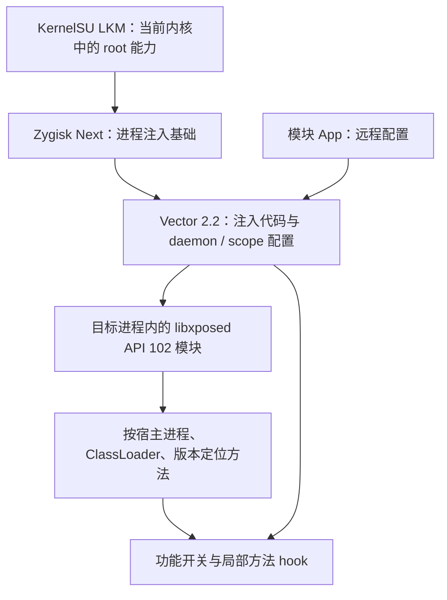

# OriginTweaks 0.1.6

OriginOS 7 运行时模块（**libxposed API 102**，Vector / LSPosed 兼容）。
只做内存 hook；不写 `/system`、`/vendor`，不挂载，不主动重启整机。

> 2026-11-16 的研究与复盘已并入本文。[OriginOS 7 Hook 策略](#originos-7--vector-22-hook-策略原-originos-hook-strategymd) · [加载与打包复盘](#复盘与加载打包契约原-origin-tweaks-reviewmd)
> 本文历史安装/生效步骤受仓库设备红线约束。见 [AGENTS.md](../../AGENTS.md) §1。
>
> 本目录是从早期 `originos/OriginTweaks`（0.1.5）复制出来的工作副本。Vector/KernelSU 历史资料见 [VECTOR-KSU.md](../../originos/root/VECTOR-KSU.md)。

## 功能

1. **拖放直达全放行**（`com.vivo.globaldragdrop` 4.1.3.0）
   - `vb.p.h(pkg, activity)` → true
   - `bb.a.a(pkg, list)` 在 `yb.f` 调用且原值为 null 时返回占位非空值
2. **超级拖拽“系统分享”选项**
   - 在 `TransIslandIntentionBean.getMServiceInfo()` 的列表头部注入一个
     `IntentionService`，operation 为 `skill=shareText`
   - hook `ne.f.a`，对该 serviceId 用拖拽的 `ClipData` 拉
     `Intent.createChooser(ACTION_SEND / SEND_MULTIPLE)`
3. **超级拖拽设置页液态玻璃**
   - `SuperDraggingSettingActivity` onResume 后：`FLAG_BLUR_BEHIND` +
     `setBackgroundBlurRadius(80)` + 半透明底色
4. **原子工作台外屏解锁**（system_server + launcher + recents）
   - `VivoMultiTaskManagerService.isSupportVivoMultiTask()`：仅当折叠屏、
     `IS_FOLD` 且其他限制（Xspace/超级省电/儿童模式/简易桌面）都未触发时，
     把外屏的 false 改 true
   - `VivoTaskMenuView.showAtomicTask()`：外屏任务菜单原本因
     `!FoldedStateMonitor.isFoldableOpenState()` 直接返回 false；仅对该调用点
     把折叠状态视为“打开”，让“原子工作台”菜单项出现
   - `SysUINavigationMode.canTriggerMultiTaskGestureAction()`：外屏原本因
     `isPhone()` 为 false 而禁用手势区；仅在触摸命中多任务手势区时放行
5. **多分屏外屏槽位 2 → 4**（launcher）
   - `LauncherEnvironmentManagerMain.G()` / `a3.b.G()` 仅在调用方是
     `com.bbk.launcher2.launcherBasic.splitwindow.a` 时返回 true
   - 对应 `DesktopSplitSelectManager` 的 `isInnerScreen ? 4 : 2`，以及
     `SplitSelectControlView.O(true)` 的 4 槽位 UI
   - 分屏请求 `VivoMultiWindowRequest` 的 displayId 默认 0；折叠时外屏就是
     default display 0，请求/服务端不需要额外改 displayId
6. **内屏后台也支持“堆叠”样式**（com.vivo.recents / QuickstepPlugin）
   - `RecentsPreferences.getLayoutMode()` 在内屏原本强制走 page/grid；
     当用户在“应用 → 后台近期应用 → 后台样式”选择“堆叠”
     （Secure `recents_view_mode == 0`）时，内屏也返回 128（堆叠）
   - 设置页说明文字改为手机版描述（不再显示“内屏仅支持平铺”）
7. **超级拖拽设置页列出全部已安装应用**
   - 设置页原本只读厂商 JSON 白名单（`EnhancedDragWhiteListV2` /
     `EnhancedDragFeatureListV2`）
   - 仅在 `jh.z`（`SuperDraggingSettingActivity` 的列表加载器）调用
     `bb.a.c()` 时，把启动器可见的全部已安装 App 合并进返回列表；
     不改缓存，不影响运行时拖放判断
   - 新加入的 App 开关默认开（`y0.b()` 里没有记录即 true）；之前被手动
     关掉的 App 仍保持关闭

## 打包（重要）

当前是 **modern libxposed**，APK 必须包含：

```
AndroidManifest.xml
classes.dex
META-INF/xposed/module.prop
META-INF/xposed/java_init.list
META-INF/xposed/scope.list
```

`module.prop`：

```properties
minApiVersion=102
targetApiVersion=102
staticScope=true
```

`java_init.list`：

```
dev.ganvivo.origintweaks.LibXposedEntry
```

`scope.list`：

```
system
com.vivo.globaldragdrop
com.bbk.launcher2
com.vivo.recents
```

不要放 `assets/xposed_init`。不是因为它会导致 `NONE`（Vector 的加载器
先看 `targetApiVersion`，`>=101` 就是 MODERN，两个入口都在也仍然走
MODERN），而是因为 modern 根本不会读它，留着只会让维护者误判。

`staticScope=true` **只收窄 scope 列表**，不会自动勾选目标。安装后仍要：

1. 在 Vector 里启用模块；
2. 打开 scope，把 4 个目标打勾；
3. 软重启（或至少 force-stop 目标 App 后重开）。

## 安装/生效

- 构建：`VERSION_NAME=0.1.6 VERSION_CODE=6 ./build.sh`
- 产物：`dist/OriginTweaks-0.1.6.apk`
- 生效需要软重启（重启 zygote / system_server），**不要硬重启**。
- 拖放/桌面类改动也可通过 force-stop 对应应用观察，但建议统一软重启。

## 验证链（必须按顺序看日志）

```
VectorModuleManager: Loading module dev.ganvivo.origintweaks
VectorModuleManager: Loaded module dev.ganvivo.origintweaks successfully
  → 目标进程 logcat: OriginTweaks: libxposed module loaded process=...
  → 目标进程 logcat: OriginTweaks: libxposed onPackageLoaded pkg=...
    → 具体 hook 日志（drag gate pass / settings app list expanded / ...）
      → 功能实际生效
```

只看到第一条 = 模块被识别；只看到第三条 = 被注入；最后一条才是功能成功。

## 构建校验

- `apksigner verify`：v3 通过（v1/v2 未启用）
- 已确认 APK 内含 `classes.dex`、`META-INF/xposed/module.prop`、
  `java_init.list`、`scope.list`；不含 `assets/xposed_init`
- 详细静态审计见 [AUDIT.md](AUDIT.md)（0.1.0 的历史审计，已加修正说明）

## 已知限制 / 未验证

- 原子工作台外屏的 system_server 侧路径已经按默认显示区放行；实际卡片
  布局/动画由 WMShell 控制器完成，该控制器不在已拉取的 APK 里，**未真机验证**。
- 外屏 4 分屏在 1120×2528 上的实际几何；部分 App 可能因最小尺寸/不支持
  分屏被系统拒绝。
- 系统 chooser 在拖拽浮层场景下是否允许后台启动 Activity。
- 全部 App 列表在真机上的加载耗时与图标内存占用。
- 超级拖拽菜单项的图标克隆自当前列表第一项；列表为空时用系统 share 图标。
- 玻璃效果依赖系统允许 `BLUR_BEHIND`；无效时只会有半透明底色。
- 所有 hook 都做了类/方法缺失保护；目标 APK 升级后类名变化时会静默跳过并打
  `OriginTweaks` 日志。

## 待办（按优先级）

1. 先把 `system` 相关 hook 做成远程偏好开关，默认关；先只验证
   `com.vivo.globaldragdrop`。
2. 用 `_tmp_probe` 同款最小模块确认 Vector 能加载/注入，再查业务 hook。
3. 把 `fromYbF()` / `fromSplitWindow()` / `fromSettingsLoader()` 的栈帧判断
   换成 ThreadLocal 或 call-site hook（`RecentsHooks` 已有正确示范）。
4. 真机按 README 的验证链逐项记录，不要把静态审计当功能验收。

> 本文件已合并原根目录 `origin-tweaks-REVIEW.md` 与本目录 `NOTES.md`、`AUDIT.md`、`ORIGINOS-HOOK-STRATEGY.md`、`VECTOR-2.2-RESEARCH.md`；构建复用 `../../shared/build-lib.sh` 与 `../../shared/libs/libxposed-api-102.jar`。

---

## 复盘与加载/打包契约（原 origin-tweaks-REVIEW.md）

# OriginTweaks 复盘：哪些是弯路，哪些是证据

日期：2026-11-16  
对象：`originos/OriginTweaks`（工作副本，当前放在只读参考目录下）  
配套：`root/VECTOR-KSU.md`（Vector / KernelSU / 临时 root 的加载规则）

> 本文只做复盘。`originos/` 保持只读；工作副本已复制到
> `origin-tweaks/`（0.1.6，修正了打包注释、manifest/版本文档），
> 后续修改只在工作副本里做。

---

## 0. 一句话结论

**这次最大的弯路不是某个 hook 写错，而是顺序错了：先写了 7 个功能、4 个
进程的 hook，之后才去读 Vector 的模块加载器。** 结果把一个「模块有没有被
注入」的问题，误诊成「APK 里两个入口文件冲突」，又用 `staticScope` 去补，
文档还停在 classic API 93。真正该先做的三件事是：

1. 读 `FileSystem.loadModule()` / `ModuleDetection.inspect()`，确认模块会不会被加载；
2. 读 `DragDropPlus` 等已跑通的参考模块，复用它们的锚点；
3. 先用一个 10 行的 Probe 确认 `onModuleLoaded` / `onPackageLoaded` 出现，
   再写业务 hook。

---

## 1. 时间线（dist 里的物证）

| 时间 | 版本 | `assets/xposed_init` | `module.prop` | 说明 |
|---|---|---|---|---|
| 15:40 | 0.1.0 | 有（`HookEntry`） | `minApi=102 targetApi=102 staticScope=false` | dex 里同时有 classic `HookEntry` 和 modern `LibXposedEntry` |
| 15:49 | 0.1.1 | 有 | 同上 | 未解决 |
| 16:01 | 0.1.2 | **删掉** | `staticScope=false` | 误诊为「两个入口 → NONE」 |
| 16:06 | 0.1.3 | 无 | **`staticScope=true`** | 列表收窄，但仍不会自动勾选 |
| 16:07 | 0.1.4 | 无 | `staticScope=true` | — |
| 16:17 | 0.1.5 | 无 | `staticScope=true` | `originos/OriginTweaks` 的最新原样副本 |
| 16:58 | 0.1.6 | 无 | `staticScope=true` | **工作副本** `origin-tweaks`：修正注释/manifest/版本文档 + 加载日志，业务 hook 未改 |
| 16:19 | — | — | — | `_tmp_vector/vdb2.dump`：模块 `enabled=1`，4 条 scope 行 |
| 16:26 | — | — | — | `_tmp_vector/vdb3.dump`：同上 |

`vdb` 里已经能看到：

```sql
INSERT INTO modules VALUES(327,'dev.ganvivo.origintweaks', '.../base.apk',1,0);
INSERT INTO scope VALUES(327,'com.vivo.globaldragdrop',0);
INSERT INTO scope VALUES(327,'com.bbk.launcher2',0);
INSERT INTO scope VALUES(327,'com.vivo.recents',0);
INSERT INTO scope VALUES(327,'system',0);
```

也就是说：**数据库层面模块是启用且已勾选 scope 的**。后面如果仍没有日志，
问题就不在「装没装/勾没勾」，而在「进程有没有被注入、hook 有没有挂上」。

---

## 2. 已证实 / 未证实

### 已证实

- 0.1.0 / 0.1.1 的 APK 同时含 `assets/xposed_init` 与
  `META-INF/xposed/java_init.list`；0.1.2 起删除前者。
- 0.1.0 的 dex 同时含 classic `HookEntry`（`IXposedHookLoadPackage`）与
  modern `LibXposedEntry`（`XposedModule`）。
- `module.prop` 从 0.1.0 起就是 `targetApiVersion=102`；0.1.3 起
  `staticScope=true`。
- 设备 Vector DB 里模块 `enabled=1`，4 条 scope 行齐全。
- `vb.p.h(pkg, activity)` 在 4.1.3.0 的 `yb.f` 里确实是拖放白名单闸门；
  `bb.a.a` 在同一处只做 null 判断。
- `ge.a.b`、`he.n.q`、`ne.f.a` 的签名与 `ShareHooks` 的假设一致。
- `RecentsPreferences.getLayoutMode()`、`FoldedStateMonitor.isFoldableOpenState()`、
  `VivoTaskMenuView.showAtomicTask()` 的调用链与注释一致。

### 未证实（必须真机日志）

- 模块是否真的被 daemon 加载（`VectorModuleManager` 日志）；
- `onPackageLoaded` / `onSystemServerStarting` 是否真的进了目标进程；
- 各 hook 是否挂上、命中；
- WMShell 的 `mRootTaskController` 在外屏如何排版；
- 外屏 4 分屏的实际几何；
- 系统 chooser 在拖拽浮层场景能否后台启动。

**AUDIT.md 自己写了「静态审计，没有安装到手机」**，所以它不能证明
「不会崩」，也不能证明「功能生效」。

---

## 3. 九条弯路

### 3.1 把「两个入口」误诊成 NONE（最贵的一条）

`originos/OriginTweaks/build.sh:72-74` 写着：

> Modern libxposed modules must NOT ship the legacy `assets/xposed_init`
> marker: Vector 2.2's module.prop parser classifies a package carrying both
> entries as NONE and silently drops it from the module map.

源码不是这样。`root/.upstream/Vector-88f8e1fa/daemon/.../FileSystem.kt:272-295`
的优先级是：

```kotlin
val strategy = when {
  targetApi >= 101 -> "MODERN"          // 先看 targetApi
  hasLegacyFile -> "LEGACY"             // 再看 assets/xposed_init
  targetApi == 100 -> "UNSUPPORTED"
  else -> "NONE"
}
```

`targetApiVersion=102` 时，**两个入口同时存在也走 MODERN**，读的是
`META-INF/xposed/java_init.list`；`assets/xposed_init` 根本不会被读。
`ModuleDetection.inspect()` 也是先看 `java_init.list`，有就按 modern 返回。

所以 0.1.2 删 `assets/xposed_init` 不是修复，只是把无用文件清掉。
真正要查的是：`java_init.list` 里的类在不在 dex、模块有没有 enabled、
目标有没有在 scope 里、目标进程有没有重启。

### 3.2 把 `staticScope` 当成「自动生效」开关

`staticScope` 的语义是**限定哪些 App 可以被列出来**，不是自动勾选：

> `staticScope` means the module fixes which apps may be listed, not which of
> them are hooked. `packages` is the outer limit and the user cannot widen it,
> but which of those packages are in the scope remains theirs to choose.

`root/.upstream/Vector-88f8e1fa/manager/.../ModuleDetection.kt:242-255`

所以 0.1.3 把 `staticScope=false` 改成 `true`，只是让 scope 页面从「几百个
App」变成「4 个目标」，用户仍然要手动打勾。`vdb2/vdb3` 里 4 条 scope 行
说明后来确实勾了；但这不是「改一个字段就生效」的证据。

补充：`staticScope=true` 且 `scope.list` 为空时，Vector 会**忽略**
staticScope（当成打包错误），不会把模块锁死。

### 3.3 classic / modern 混装，自己给自己制造歧义

0.1.0 的 dex 里同时有：

- `HookEntry implements IXposedHookLoadPackage`（classic API 93）
- `LibXposedEntry extends XposedModule`（libxposed API 102）

因为 `targetApiVersion=102`，Vector 只走 MODERN，`HookEntry` 是死代码。
`Env.java` / `Hooks.java` 的注释也写了：**target API 101+ 的模块会被
Vector 屏蔽 classic `de.robv.android.xposed` 表面**。这不是「classic 不能用」，
而是「你声明了 102，就不能再指望 classic 入口」。

正确做法是二选一：

| 选择 | 需要的文件 | manifest |
|---|---|---|
| modern（推荐） | `META-INF/xposed/module.prop` + `META-INF/xposed/java_init.list`，入口继承 `XposedModule` | `xposedminversion` 可写 102，也可不写；不要放 `assets/xposed_init` |
| classic | `assets/xposed_init`，入口实现 `IXposedHookLoadPackage` | **必须**写 `xposedminversion`（manager 靠它识别 legacy） |

`fq-fold-pad` 就是纯 classic 且能工作的例子；`DragDropPlus` 是纯
modern 且能工作的例子。混装只会让后来的人分不清哪条路径在跑。

### 3.4 重新发明轮子，而不是先读参考模块

`DragDropPlus` 的 `WhiteListHooker.kt:11-35` 记录了他们自己 1.0.0/1.0.1 的
弯路：

- 先 hook `WhiteListResultBean.getResult()`，日志显示挂上但一次都没命中；
- 重新静态分析后发现它只在中转岛链路，真正的拖放起始闸门是
  `za.o.g(pkg, activity)`，整个 dex 只有 `cb.h` 一个调用点。

我们这边 4.1.3.0 的闸门是 `vb.p.h`（不是 `za.o.g`，版本不同），这一点
`DragHooks` 是对的；但 `bb.a.a` 的「栈里出现 `yb.f` 才返回 Boolean.TRUE」
是一个为了绕开 null 检查的补丁，不是从参考模块学来的稳定做法。
如果先读 `DragDropPlus`，至少会先问：「真正的 call site 是哪个？
这个 bean 有没有别的消费者？」而不是先写 4 个拖放 hook。

### 3.5 工作副本放进了只读参考目录

`originos/` 下除 `OriginTweaks` 外都有 `.git`，是上游克隆；`OriginTweaks`
没有 `.git`，是我们的。把 `build/`、`dist/`、`.signing/` 混在参考目录里，
既容易误改上游，也让「哪些是原版、哪些是我们改的」变得不清楚。

建议：`originos/` 只读；工作副本放 `origin-tweaks/`。

### 3.6 文档、版本、manifest 三处不一致

| 位置 | 写的 | 实际 |
|---|---|---|
| `README.md:1` | 0.1.0 | dist 最新 0.1.5 |
| `README.md:3` | classic Xposed API 93 | 代码是 libxposed API 102 |
| `README.md:66` | APK 含 `assets/xposed_init` | 0.1.2 起已删除 |
| `AUDIT.md:1-4` | 0.1.0 / SHA `05028d…` | 0.1.5 / SHA `95b652…` |
| `AUDIT.md:184-192` | `HookEntry`、`xposedminversion=93` | `LibXposedEntry`、`module.prop targetApi=102` |
| `AndroidManifest.xml:23-24` | `xposedminversion=93` | modern 模块实际按 `module.prop` 加载 |
| `MainActivity.java:15` | “OriginTweaks 0.1.0” | 0.1.5 |
| `build.sh:25-26` | 默认 `VERSION_NAME=0.1.2` | 0.1.5 |

`xposedminversion=93` 本身不会让 modern 模块加载失败（manager/daemon 都以
`java_init.list` 为准），但它会误导下一个维护者，也会让「到底走哪条路」
永远说不清。

### 3.7 用静态审计代替运行时验证

`AUDIT.md` 开头就写「没有把 APK 安装到手机，也没有在真机上触发 hook」。
后面却给出了「只装 APK 不会自己崩溃」「hook 安装失败不会拖垮目标进程」
这类结论。这些结论在代码层面大体成立，但不能回答：

- 模块有没有被 daemon 加载？
- 目标进程有没有收到模块？
- hook 有没有挂上、命中？
- `system_server` 的 hook 会不会让系统服务崩溃？

正确的最小验证链是：

```
VectorModuleManager: Loading module / Loaded module successfully
  → 目标进程 logcat: libxposed module loaded / onPackageLoaded
    → 具体 hook 日志（OriginTweaks）
      → 功能实际生效
```

缺任何一层，都不能说「模块生效」。

### 3.8 高风险功能默认全开

`system` scope 里的 `MultiTaskHooks` 直接改
`VivoMultiTaskManagerService.isSupportVivoMultiTask()`；`SplitHooks` 改
launcher 的槽位；`RecentsHooks` 改布局模式。AUDIT 自己也承认 WMShell 的
控制器不在已拉取的 APK 里，外屏排版只能真机验证。这些功能**没有用户开关**，
一旦某一项让 system_server 异常，用户只能停整个 `system` scope。

至少应该：

- 把 `system_server` 相关 hook 做成远程偏好开关，默认关；
- 先只开 `com.vivo.globaldragdrop`，验证拖放/分享/玻璃；
- 再开 recents/launcher，最后才开 system；
- 每步保留 logcat 和 scope 配置。

### 3.9 栈帧判断又贵又脆

`fromYbF()`、`fromSplitWindow()`、`fromSettingsLoader()`、
`fromAtomicTaskMenu()` 都是每次调用遍历 `Thread.getStackTrace()`：

- 性能：拖放/布局/设置列表都是高频路径；
- 正确性：ART 内联、R8 改名、不同调用链都可能让帧消失；
- 可读性：后来的人不知道「为什么只对这个调用方生效」。

更稳的模式是：

- 在真正的 caller 方法上挂一个 ThreadLocal 作用域（enter/exit），
  被调方法只读 ThreadLocal；
- 或者直接 hook call site 所在的方法，避免在共享方法里做栈判断。

`RecentsHooks` 已经用了 `ATOMIC_TASK_SCOPE` 的 ThreadLocal 模式，这是对的；
`DragHooks` / `SplitHooks` / `SettingsListHooks` 还停留在栈帧判断。

---

## 4. 修正后的模块契约

### 4.1 打包（modern，推荐）

```
AndroidManifest.xml
classes.dex
META-INF/xposed/module.prop
META-INF/xposed/java_init.list
META-INF/xposed/scope.list
```

`module.prop`：

```properties
minApiVersion=102
targetApiVersion=102
staticScope=true
```

`java_init.list`：

```
dev.ganvivo.origintweaks.LibXposedEntry
```

`scope.list`：

```
system
com.vivo.globaldragdrop
com.bbk.launcher2
com.vivo.recents
```

注意：

- **不要**再放 `assets/xposed_init`（不是因为它会导致 NONE，而是因为
  modern 根本不会读它，留着只会让文档自相矛盾）；
- `xposedminversion` 可以写 102 或删掉，但不要写 93；
- `versionCode` / `versionName` 以 `build.sh` 的 `--version-code` /
  `--version-name` 为准，manifest 和 `MainActivity` 不要各写一套。

### 4.2 安装后必须确认

1. Vector 模块列表里能看到 `OriginTweaks`，且开关为开；
2. scope 页面 4 个目标全部打勾（`staticScope` 只收窄列表，不自动勾）；
3. 软重启（或至少 force-stop 目标 App 后重开）；
4. `logcat -s VectorModuleManager` 出现 `Loaded module dev.ganvivo.origintweaks successfully`；
5. 目标进程 `logcat -s OriginTweaks` 出现 `libxposed module loaded` /
   `onPackageLoaded pkg=...`；
6. 再验证具体功能日志。

### 4.3 测试顺序

| 顺序 | scope | 验证 |
|---|---|---|
| 1 | `com.vivo.globaldragdrop` | 拖放放行、系统分享、玻璃 |
| 2 | `com.vivo.globaldragdrop` | 设置页全部 App |
| 3 | `com.vivo.recents` / `com.bbk.launcher2` | 内屏堆叠、任务菜单、外屏手势 |
| 4 | `system` | 原子工作台（默认关，单独开） |

每步都记录：模块版本、scope、目标 App 版本、logcat 关键行、实际现象。
没有这些，不要写「已适配」。

---

## 5. 建议的下一步（未执行）

> 2026-11-16：第 1 步已做——`origin-tweaks/` 是 0.1.6 工作副本，
> `originos/OriginTweaks` 原样保留。以下 2–8 仍未执行。

1. 把工作副本从 `originos/OriginTweaks` 复制到 `origin-tweaks/`，
   `originos/` 保持只读；
2. 修正 `build.sh:72-74` 的错误注释；
3. 统一版本：`README` / `AUDIT` / `MainActivity` / `AndroidManifest` /
   `build.sh` 全部指向 0.1.5（或下一个版本号）；
4. `AUDIT.md` 增加「2026-11-16 修正」一节：把「both entries → NONE」
   改成源码实际的优先级规则，并标注哪些结论是静态推断；
5. 增加一个最小 Probe 构建（或复用 `_tmp_probe`），先验证模块加载；
6. 把 `system` 相关 hook 加远程开关，默认关；
7. 逐步把栈帧判断换成 ThreadLocal / call-site hook；
8. 真机按 §4.3 的顺序逐项验证，保留日志。

---

## 6. 证据索引

| 结论 | 证据 |
|---|---|
| 两个入口不会 NONE | `root/.upstream/Vector-88f8e1fa/daemon/.../FileSystem.kt:272-295` |
| manager 先看 java_init.list | `root/.upstream/Vector-88f8e1fa/manager/.../ModuleDetection.kt:80-140` |
| staticScope 只收窄列表 | `ModuleDetection.kt:242-255`；`FileSystem.readStaticScope()` |
| 0.1.0/0.1.1 有两个入口 | `unzip -l originos/OriginTweaks/dist/OriginTweaks-0.1.0.apk` |
| 0.1.2 删除 legacy 入口 | 同上，0.1.2 |
| 0.1.3 staticScope=true | 0.1.3 的 `META-INF/xposed/module.prop` |
| DB 已启用且已勾 scope | `_tmp_vector/vdb2.dump:44,74-77`；`vdb3.dump` 同 |
| 拖放闸门 `vb.p.h` | `originos/device-apks/decompiled/com.vivo.globaldragdrop/sources/yb/f.java:239-275` |
| `bb.a.a` 只做 null 判断 | 同上 `:239` |
| DragDropPlus 的旧弯路 | `originos/DragDropPlus/.../WhiteListHooker.kt:11-35` |
| Vector 3080 崩溃 | `root/vector-softreboot/FINDINGS.md` |
| Vector 3118 修复 | `root/.upstream/vector` git log（`5690481`、`eaffc81`） |

---

## 运行验证矩阵（原 NOTES.md）

# OriginTweaks 0.1.6 运行记录

> 这份文件只记录**真机证据**。没有 logcat 的项，保持“未验证”。
> 加载规则与弯路复盘见 `../origin-tweaks-REVIEW.md`。

## 1. 安装前

- [ ] 目标 App 版本（`com.vivo.globaldragdrop` / `com.bbk.launcher2` /
      `com.vivo.recents`）记录到下表
- [ ] Vector manager / daemon 版本一致
- [ ] 只有一个 `vectord`
- [ ] 备份当前 `daemon.apk` / `manager.apk`

## 2. 加载验证

```sh
adb logcat -c
adb logcat -s VectorModuleManager VectorDaemon VectorModuleManager OriginTweaks
```

期望顺序：

1. `VectorModuleManager: Loading module dev.ganvivo.origintweaks`
2. `VectorModuleManager: Loaded module dev.ganvivo.origintweaks successfully`
3. `OriginTweaks: libxposed module loaded process=... systemServer=...`
4. `OriginTweaks: libxposed onPackageLoaded pkg=...`

任何一步缺失，先停下查加载/scope，不要继续加 hook。

## 3. 功能矩阵

| # | 功能 | scope | 目标版本 | 操作 | 日志/现象 | 结论 |
|---|---|---|---|---|---|---|
| 1 | 拖放直达 | globaldragdrop | 4.1.3.0 | 长按拖文字/图片 | `drag gate pass` | 未验证 |
| 2 | 系统分享 | globaldragdrop | 4.1.3.0 | 超级拖拽菜单 | `system share chooser launched` | 未验证 |
| 3 | 液态玻璃 | globaldragdrop | 4.1.3.0 | 打开超级拖拽设置 | `glass applied` | 未验证 |
| 4 | 设置页全部 App | globaldragdrop | 4.1.3.0 | 打开设置页 | `settings app list expanded` | 未验证 |
| 5 | 内屏堆叠 | recents | — | 设置里选“堆叠”后进后台 | `inner recents layout -> 堆叠` | 未验证 |
| 6 | 任务菜单工作台 | recents | — | 外屏任务菜单 | `recents atomic-task menu unlocked` | 未验证 |
| 7 | 外屏手势 | launcher | — | 外屏多任务手势区 | `outer multi-task gesture unlocked` | 未验证 |
| 8 | 外屏 4 分屏 | launcher | — | 分屏选择 3/4 个 App | UI 槽位/实际分屏 | 未验证 |
| 9 | 原子工作台 | system | — | 外屏进入工作台 | system_server 异常/卡片 | 未验证（高风险） |

## 4. 失败时先看什么

1. `logcat -s VectorModuleManager` 有没有 `Loaded module ... successfully`；
2. `logcat -s OriginTweaks` 有没有 `onPackageLoaded pkg=...`；
3. 没有第 2 条 → 目标进程没被注入：检查 scope、目标进程是否重启、
   `ConfigCache` 是否已刷新；
4. 有第 2 条但没有 hook 日志 → `Class.forName` / 方法签名失败，
   看 `hook failed` / `NoSuchMethodError`；
5. 有 hook 日志但功能无效 → 锚点选错或返回值被后续逻辑覆盖，
   回到反编译核对 call site。

## 5. 已知未验证项

- WMShell `mRootTaskController` 在外屏的卡片布局/动画；
- 外屏 4 分屏的实际几何与 App 最小尺寸拒绝；
- 系统 chooser 在拖拽浮层场景的后台启动限制；
- `system` scope 下 hook 对 system_server 稳定性的影响。

这些只能真机验证；静态审计不能替代。

---

## OriginOS 7 / Vector 2.2 Hook 策略（原 ORIGINOS-HOOK-STRATEGY.md）

# OriginOS 7 / Vector 2.2 / 临时 root：本机 hook 方案研究

研究日期：2026-11-16。范围：本仓库现存源码、采集记录，以及固定提交的一手上游源码。
本轮未连接设备、未安装 APK、未修改 hook 业务代码，也未执行任何 root/框架恢复动作。

## 结论

推荐沿用 **KernelSU LKM 提供 root → Zygisk Next 提供注入 → Vector 2.2 提供 ART hook → libxposed API 102 模块实现功能** 的分层方案。临时 root 主要约束框架初始化和进程生命周期；模块进入宿主以后，Java hook 的编写方式无需另造一套“临时 root API”。已有 XHook 日志证明 Vector 2.2/API 102 在本机 Android 17 上曾成功加载并命中业务方法，但不能据此认定 OriginTweaks 已适配。[E1]、[E2]、[E3]

**目前适合推进的是应用进程内、按功能开关控制的窄范围 hook。现有 OriginTweaks 0.1.6 应作为待完善的工作副本，不能直接当整套可用方案。** 优先解决加载时序、类加载器、版本匹配与部分安装失败，再研究拖放功能；桌面/最近任务另设阶段，涉及 `system_server` 的外屏工作台暂留静态研究。依据是现存代码缺口、全部未验证的功能记录和设备红线，而不是仅凭“写了 try/catch”判断安全。[E4]、[E5]、[E6]

## 1. 本机基线与证据强度

这里的“最新系统”指仓库中最近的本机采样，**不是所有 vivo 最新机型/固件的通用兼容声明**。

| 项目 | 本轮能确认的内容 | 证据与限制 |
|---|---|---|
| 设备/系统快照 | V2545A / PD2545D；`PD2545D_A_17.1.13.20.W10`；系统构建 2026-11-06，SPL 2026-10-01 | 11-15 11:45 的 [MANIFEST.md](../../root/device-dump/pd2545-B-17.1.13.20/MANIFEST.md#L9)；本轮未实时复核 |
| 内核 | `6.12.58-android16-6-gdd6fd5c98918`；构建日期 2026-08-05 | 同一快照；8 月日期属于内核，不能当成系统构建日期 |
| root | 该快照记录 KernelSU v3.3.1 LKM、内存加载、AVB green / locked | 证明当时状态；不证明当前仍有 root |
| Vector / Zygisk Next | 留存模块属性为 Vector `2.2 / 3080 / 88f8e1fa`、Zygisk Next `1.5.3 / 880` | [Vector 属性](../../root/vector-softreboot/device/module_prop.txt)、[Zygisk Next 属性](../../root/vector-softreboot/device/znext_module_prop.txt) |
| 较晚运行证据 | 11-15 23:12，Vector 2.2/API 102；宿主 `com.twitter.android`；Android 17/API 37；随后有实际广告跳过记录 | [XHook 原始日志](../../xhook/notes/logcat-0.3.1-verified.txt#L1)，只能证明该时间窗口内的功能 |
| OriginTweaks | 源码版本 0.1.6；运行记录中九项功能均未验证 | [NOTES.md 功能矩阵](NOTES.md#L30)，不能把旧静态审计升级为真机验收 |
| 缺失材料 | 当前工作区没有 `originos/`、`root/.upstream/`、`_tmp_vector/`；没有旧文档指向的 vivo APK 反编译树 | 这些目录被历史文档引用，但本轮不能重新核对其中的 vivo 私有实现或 DB dump |

时间线要同时读：19 点事故记录说临时 root/Vector 丢失、0.1.6 未安装；23 点的 XHook 日志又显示 Vector 已经工作。两者描述不同时间段。不能只引用事故记录宣布“现在没 root”，也不能只引用 18:34 恢复记录宣布“当前完全正常”；中间的恢复过程和当前状态仍需新的现场证据。[E2]、[E3]

## 2. 技术路线与临时 root 的边界



这是职责图，**不是可直接执行的初始化步骤**。

- **有 root 不等于已经具备注入条件。** KSU、Zygisk、Vector 桥接/daemon 和目标进程的加载是不同层；应分别核对。`su` 正常不能证明模块收到生命周期回调。[E1]、[E7]
- **宿主里的模块代码仍受宿主身份与 Android 行为约束。** 不能因为 Vector daemon 有 root，就假设分享 chooser 能任意后台启动、URI 能任意转授、模块 App 的私有配置能被宿主直接读取。配置应走 libxposed 的远程服务；分享仍需要满足 Activity 启动与 URI 读取条件。[E8]、[E9]
- **不把框架重启当日常开发步骤。** Vector 3080 已有多 daemon/转发递归的留存崩溃证据；历史就地升级还记录了混代运行与 DB 迁移事故。根规则已经禁止可能导致重启的操作，旧 README 的“软重启即可生效”不能作为当前操作依据。[E6]、[E10]
- **修改启用状态或 scope 不能当作对已运行进程的即时撤销。** 后续设计应让已装入的 callback 在开关关闭时走原逻辑，并管理 HookHandle；这也不能撤销已经发出的窗口请求、对象修改或正在执行的调用。[E7]

新功能推荐纯 modern API 102；已验证的 classic 模块可按各自入口继续维护。两套入口的规则要区分：Vector 3080 的 MODERN 分类门槛是 `targetApiVersion >= 101`，但屏蔽 classic 类表面的门槛实际为 `>= 102`。旧文档把两个门槛混写了。详细固定源码、scope、回调和热重载条件见 [Vector 一手源码附录](VECTOR-2.2-RESEARCH.md)。

## 3. 按功能选择 hook 点

以下“现有锚点”表示本模块现在尝试挂载的符号，不表示本轮已重验对应 vivo APK。

| 功能 | 现有锚点 / 所属范围 | 推荐方案与验收边界 |
|---|---|---|
| 拖放直达放行 | `com.vivo.globaldragdrop`；`vb.p.h(String,String)`，以及 `yb.f → bb.a.a` 的配置检查 | 优先定位真正处理拖拽起始消息的调用链，保留空包名/空 Activity/`NA` 的原有拒绝；只对已匹配版本启用。`Boolean.TRUE` 配置占位依赖调用方只检查 null，不能泛化到新版本。见 [DragHooks.java](src/dev/ganvivo/origintweaks/DragHooks.java#L22) |
| 超级拖拽设置页扩展 | `jh.z → bb.a.c()`、`kb.i1.b` | 只改列表加载范围；当前主要合并 PackageManager 可见且有启动入口的 App，并非无条件列出所有安装包。考虑列表查询耗时、去重和用户原有关闭状态。见 [SettingsListHooks.java](src/dev/ganvivo/origintweaks/SettingsListHooks.java#L70) |
| “系统分享”菜单 | `TransIslandIntentionBean.getMServiceInfo`、`ne.f.a`、`ge.a.b`、`he.n.q` | 必须先确认 synthetic service 的消费链全部可用，再注入菜单项。分别验证纯文本、单 URI、多 URI、读取授权、后台启动条件；菜单出现不等于分享完成。见 [ShareHooks.java](src/dev/ganvivo/origintweaks/ShareHooks.java#L35)、[E9] |
| 设置页玻璃效果 | `Instrumentation.callActivityOnResume` 中按 Activity 类名筛选 | 可以作为较小的界面适配项目；进一步限定精确 Activity。窗口模糊是否可见仍受窗口属性、内容背景和系统模糊支持影响。见 [GlassHooks.java](src/dev/ganvivo/origintweaks/GlassHooks.java#L24) |
| 内屏最近任务堆叠 | `RecentsPreferences.getLayoutMode()`；当前代码同时尝试 launcher 和 recents | 只改最终布局模式，保留用户偏好；先确认 QuickstepPlugin 类实际由哪个进程、哪个 ClassLoader 加载。不要全局伪造“手机/平板/内屏”身份。见 [RecentsHooks.java](src/dev/ganvivo/origintweaks/RecentsHooks.java#L33) |
| 外屏 4 分屏 | launcher 的 `LauncherEnvironmentManagerMain.G()` / `a3.b.G()`，限制在分屏调用链 | 应优先定位槽位计算/选择器的局部逻辑。UI 出现 4 槽，只证明入口变了；还要核对请求、WMShell stage 布局、应用最小尺寸和折叠切换。见 [SplitHooks.java](src/dev/ganvivo/origintweaks/SplitHooks.java#L28) |
| 外屏原子工作台 | recents 菜单 + launcher 手势 + `system_server` 的 `VivoMultiTaskManagerService` | 是跨进程功能，不能只放行三个布尔闸门就宣称成功。保留静态研究，先补 WMShell 控制器与显示迁移证据；当前红线下不安排系统进程实验。见 [MultiTaskHooks.java](src/dev/ganvivo/origintweaks/MultiTaskHooks.java#L21)、[AUDIT.md 的未知项](AUDIT.md#L198) |

“应用进程内”只表示影响范围相对集中；拖放、桌面、最近任务仍是系统组件，不因此获得设备操作授权。

### 上游 DragDropPlus 可以借鉴什么

本轮从作者仓库核对到提交 `3f63251ce8fe346cf855b0686edbc4677fb279d6`，版本文件为 1.0.3。其 [WhiteListHooker.kt](https://github.com/QIANMIANMIANMIAN/DragDropPlus/blob/3f63251ce8fe346cf855b0686edbc4677fb279d6/app/src/main/java/com/vivo/dragdrop/plus/xposed/WhiteListHooker.kt#L11) 记录：旧版 hook `WhiteListResultBean.getResult()` 未命中，随后改到 `cb.h → za.o.g(String,String):boolean` 的拖拽起始闸门。它还按参数和返回类型精确找方法。[E11]

这支持“沿真实调用链找最终裁决点”的方法；**不支持直接把 `za.o.g` 复制到本机 4.1.3.0**。本地代码使用的是 `yb.f → vb.p.h`，版本间混淆名不同。值得警惕的是同一上游提交的 [README](https://github.com/QIANMIANMIANMIAN/DragDropPlus/blob/3f63251ce8fe346cf855b0686edbc4677fb279d6/README.md#L30) 仍推荐旧的 `getResult()`，并说明分析样本为 4.1.0.0；因此优先核对执行代码和目标 APK，而不是复制 README 中的结论。

## 4. 当前 0.1.6 的优先修正项

这是本轮的静态结论及设计建议，未改业务实现；也未认定它们已经在设备上触发。

### 4.1 加载时序和“尝试过就不再重试”

[LibXposedEntry.java](src/dev/ganvivo/origintweaks/LibXposedEntry.java#L39) 在 `onPackageLoaded` 和 `onPackageReady` 都使用 `getDefaultClassLoader()`；`INSTALLED.add(pkg)` 又在实际挂 hook 前执行。各功能的 `install()` 内部通常捕获异常并返回 void，因此第一次失败后，ready 阶段会直接因包名已登记而跳过。[E4]

官方契约区分两个阶段：loaded 在 AppComponentFactory 自定义类加载器前；ready 可通过 `getClassLoader()` 获取最终加载器。**这处时序缺陷可以从源码确认；本机目标是否真的需要定制/插件加载器，尚无现场证据。** [E7]

建议应用业务 hook 默认在 ready 使用最终加载器；只有必须更早拦截的功能才进入 loaded。状态按“宿主进程 + 加载器身份 + 功能 + 方法”记录，区分已解析、已挂载、失败和已命中；失败不能等同于成功。保留每个实际成功挂载的 handle，避免重试导致重复 hook。XHook 的 [入口](../../xhook/ours/app/src/main/java/dev/xhook/XHookModule.java#L23) 和 [Context 就绪处理](../../xhook/ours/app/src/main/java/dev/xhook/Bootstrap.java#L24) 可参考，但不要机械复制“只接受 first package”：宿主后加载的 Quickstep 插件可能需要独立处理。

### 4.2 版本保护不足

[Env.java](src/dev/ganvivo/origintweaks/Env.java#L15) 只做系统属性/品牌判断；它没有绑定 ROM 构建、目标 APK versionCode 或 dex 指纹。`vb.p`、`bb.a`、`a3.b` 等短名不能作为跨版本稳定接口。[E4]

建议建立按目标 APK 的适配表：记录包名、版本、签名/哈希、类加载来源、精确方法描述和关键调用链。未知版本先报告“不支持”，不进行同名方法的猜测式覆盖。DexKit 可辅助从稳定字符串、参数/返回类型和调用关系找候选，最终必须验证唯一候选；缓存也要绑定目标版本/指纹。仓库的 [XHook 构建依赖](../../xhook/ours/app/build.gradle.kts#L42) 和 [实际扫描耗时日志](../../xhook/notes/logcat-0.3.1-verified.txt#L9) 可作工程参考，不能把其耗时当本模块预算保证。

### 4.3 多个 hook 的依赖关系没有统一失败处理

[ShareHooks.java](src/dev/ganvivo/origintweaks/ShareHooks.java#L35) 先注册菜单注入，再分别尝试注册 skill 消费和过滤 hook；各段独立 catch。若 `ne.f` 变化导致消费 hook 失败，菜单注入仍可能存在。“无论成功失败都吞掉假 service”仅在消费 hook 成功安装时成立。[E4]

拖放也有类似依赖：配置占位值与真实闸门短路必须匹配；不能一边失败、另一边仍替换返回值。建议先解析整组目标和签名，先装消费者、后开放生产者；失败时撤销本组已注册 handle，保留原行为。当前 [Hooks.hook](src/dev/ganvivo/origintweaks/Hooks.java#L26) 返回 void、丢弃 handle，需要先改变这一接口才能可靠管理部分失败。

### 4.4 “hook installed”日志不一定代表挂上了方法

[Hooks.methods](src/dev/ganvivo/origintweaks/Hooks.java#L43) 只按方法名收集，不校验完整签名。集合为空时，ShareHooks、SettingsListHooks 等循环结束后仍会输出 installed；多个同名重载时又会全部注册。这会把“没有候选”误读成“挂上但没命中”。[E4]

建议每个功能记录实际匹配数量、完整签名、成功 handle 数和有限次数的命中计数；依赖方法数量不符就不启用。安装成功、发生调用、返回值改变和用户可见结果应是四个独立观察量。

### 4.5 栈扫描尚未被 ThreadLocal 完整替代

DragHooks、SplitHooks、SettingsListHooks 使用 `Thread.getStackTrace()`；[RecentsHooks.java](src/dev/ganvivo/origintweaks/RecentsHooks.java#L78) 虽已加入 ThreadLocal，仍保留 `fromAtomicTaskMenu()` 回退，而且 boolean 作用域的 `remove()` 没有恢复嵌套调用前的状态。[E4]

建议在已验证的 caller 上建立 `try/finally` 作用域，采用深度计数或恢复旧值，减少共享 getter 中的栈遍历；这只覆盖同线程同步调用，协程/Handler 异步链不能直接沿用。ART 内联需根据真实 caller 关系处理，不做全进程去优化。[E7]

### 4.6 系统闸门缺少精确原因判断和功能开关

[MultiTaskHooks.java](src/dev/ganvivo/origintweaks/MultiTaskHooks.java#L28) 在原结果 false 时检查若干已知模式，再返回 true；代码没有再次确认当前默认显示 uniqueId 或原始拒绝确实来自外屏。系统新增一种拒绝原因后，这个 hook 也可能把它覆盖，不能仅凭旧方法体推断永久安全。

当前 [MainActivity.java](src/dev/ganvivo/origintweaks/MainActivity.java#L9) 只有说明文字，入口对命中的包直接安装全部对应功能，没有模块内的远程开关。建议风险功能初始值为 false，读取失败也保持关闭；进入回调后仍检查功能状态。第一阶段构建的静态 scope 应只包含预定验证目标，移除 `system`；未来系统功能应有独立构建/作用域和明确实验条件，而不只依赖 UI 文案。[E4]、[E6]

`ExceptionMode.PROTECTIVE` 能处理部分 hook 异常，不保证错误的成功返回值、后续状态变化、死锁、ANR 或 native 崩溃可恢复。因此旧审计中的“不会崩”“仅为显示问题”等表述不能当保证。[E7]

## 5. 减少重启：配置与代码更新分开设计

| 方式 | 可以改变什么 | 本机方案中的限制 |
|---|---|---|
| Remote Preferences | 已注入模块的功能开关、允许列表、参数 | 模块 App 通过 libxposed service 写，宿主通过 API 读；回调需要按最新状态选择原逻辑。不是直接读模块私有 SharedPreferences。参考 [XHookApplication.java](../../xhook/ours/app/src/main/java/dev/xhook/XHookApplication.java#L29) 与 [Runtime.java](../../xhook/ours/app/src/main/java/dev/xhook/Runtime.java#L84) |
| Vector 2.2 热重载 | 满足契约的、已注入模块的代码 generation | Vector 确有实现，但旧实例必须在 `onHotReloading` 返回 true，且要求单 Java 入口。它不会自动重放全部 package/system 生命周期；新实例需在 `onHotReloaded` 接回已就绪宿主。详见源码附录 |
| 新目标进程的常规加载 | 新进程取得当前模块/配置并经历完整生命周期 | 不能由此推出可以强停系统应用；当前设备红线仍约束所有进程/安装操作 |

当前 OriginTweaks 没有覆写 `onHotReloading`，本地 API jar 的默认实现返回 false。**因此当前已注入的旧实例不能通过“新 APK 补上热重载回调”就立即获得热重载能力。** API 默认 `onHotReloaded` 已清理旧 handle；“没有覆写它”本身不是泄漏证据，但也不足以重新安装新功能。[E7]

后续可从最小模块起设计可重载的生命周期：保留宿主信息、重新解析目标、管理 handle、解除偏好监听/UI 回调，确保失败后没有半套功能。热重载不回滚已产生的业务副作用，也不自动解决 APK 安装触发的 `PACKAGE_*` 风险；不能用它绕过本机安装红线。`system_server` 即使技术路径未排除，也不纳入当前实验计划。[E6]、[E7]

模块 App 的控制端还要使用包含热重载调用的 service API 102。XHook 当前的 `service:101.0.0` 可供参考远程偏好实现，不能把该依赖原样复制后就认定已有热重载控制接口；hook API 的 102 与 service 依赖版本要分别核对。[E7]、[E8]

## 6. 建议的开发顺序与验收标准

以下是后续依赖顺序，不是本轮已执行项，也不是设备操作授权。

1. **先完善最小模块基础。** 纯 API 102、单入口、严格 scope；记录框架/进程/加载器/目标版本；修复 ready 时序和幂等状态；将危险功能默认关闭。未知版本不改行为。
2. **先用探针确认加载，不改业务结果。** 核对 daemon 归档的模块加载记录、目标生命周期回调、解析到的方法和调用计数。缺哪一层就诊断哪一层，不以升级 Vector、广播或重启补证据。
3. **拖放功能逐项验收。** 闸门、设置列表、分享、视觉效果分别启用；每项都有关闭后回到原行为的观测。安装/启用/目标生命周期变化需要满足设备规则，当前不执行。
4. **桌面/最近任务先补进程与插件证据。** 记录实际 host PID、package、ClassLoader 来源、插件 APK 路径；再讨论堆叠与分屏。外屏/内屏、切换中间态、原有布局模式分别记录。
5. **系统功能最后重新评估。** 先补齐 WMShell 控制器、display/stage 布局、模式拒绝条件的离线证据；当前禁止重启与系统进程风险的约束下，停留在研究层。

每项验收至少保留：时间、ROM 与目标 APK 版本/哈希、模块版本、scope、进程/加载器、精确方法签名、hook handle 数、命中和原/新结果、用户可见现象、关闭后的行为。日志保存在对应模块 `logs/`；模块加载以 `/data/adb/lspd/log/verbose_*.log` 的已有归档为依据，不清 logcat，也不以短时间 logcat 缺失证明“未加载”。[E6]、[E10]

目前证据只能给出：**这条 framework/API 路线可行；本地 OriginTweaks 还有明确的基础缺口，vivo 功能适配需要绑定具体包版本，跨进程多窗部分证据不足。**

## 7. 本轮核验与证据索引

本轮完成文件清点、全部 OriginTweaks Java 源码阅读、现存 XHook/Vector 日志比对、固定上游源码核对，以及本地 API jar 的 `javap`/`javap -c` 接口检查。没有进行构建或运行时测试；没有把编译成功当作兼容性证据。

本地 `libs/libxposed-api-102.jar` SHA-256：
`a515dd7a53cd7a47c05e101dff77d61acb3091a97b20a885b9ea3494412db985`。
其中 `PackageReadyParam` 增加 `getClassLoader()`；默认 `onHotReloading()` 返回 false；默认 `onHotReloaded()` 遍历旧 hook handles。官方对应实现与 Vector 固定提交详见附录。

| 编号 | 来源 | 能支持的结论 |
|---|---|---|
| E1 | [设备快照 MANIFEST.md](../../root/device-dump/pd2545-B-17.1.13.20/MANIFEST.md#L9)、[VECTOR-KSU.md](../../root/VECTOR-KSU.md#L10) | 快照中的 ROM/内核/root 与历史分层说明；后者操作建议受新红线覆盖 |
| E2 | [23:12 XHook 原始日志](../../xhook/notes/logcat-0.3.1-verified.txt#L1) | Vector 3080/API 102、Android 17、目标模块加载及业务命中 |
| E3 | [PackageInstaller 事故](../../root/INCIDENT-2026-11-15-packageinstaller.md#L6) | 19 点事故与当时 root/安装状态，不代表本轮实时状态 |
| E4 | [LibXposedEntry.java](src/dev/ganvivo/origintweaks/LibXposedEntry.java)、[Hooks.java](src/dev/ganvivo/origintweaks/Hooks.java) 及本报告各功能的源码链接 | 当前实现的行为与静态缺口 |
| E5 | [NOTES.md](NOTES.md#L30)、[AUDIT.md](AUDIT.md#L15)、[复盘](../origin-tweaks-REVIEW.md#L69) | 功能未验证、历史静态分析及其局限 |
| E6 | [根 AGENTS.md](../../AGENTS.md#L27) §1 | 当前操作边界；其余文档不能覆盖 |
| E7 | [Vector 2.2 一手源码附录](VECTOR-2.2-RESEARCH.md) | 固定提交的打包、scope、类加载器、异常、内联、配置与热重载实现 |
| E8 | [XHook 模块 App 配置实现](../../xhook/ours/app/src/main/java/dev/xhook/XHookApplication.java#L29)、[宿主配置读取](../../xhook/ours/app/src/main/java/dev/xhook/Runtime.java#L84) | 两进程通过 Remote Preferences 交换配置的仓库实现 |
| E9 | Android 官方 [后台 Activity 启动约束](https://developer.android.com/guide/components/activities/background-starts)、[发送共享数据](https://developer.android.com/training/sharing/send) | 分享启动、接收端 URI 权限要求；不是 vivo 现场通过证明 |
| E10 | [原始崩溃缓冲](../../root/vector-softreboot/device/crash-buffer.txt#L20)、[故障分析](../../root/vector-softreboot/FINDINGS.md#L89)、[升级事故时间线](../../root/VECTOR-KSU.md#L474)、[安装事故](../../root/INCIDENT-2026-11-15-packageinstaller.md) | daemon 崩溃与历史操作后果；失效的旧处置建议不能直接执行 |
| E11 | 作者仓库 [WhiteListHooker.kt 固定提交](https://github.com/QIANMIANMIANMIAN/DragDropPlus/blob/3f63251ce8fe346cf855b0686edbc4677fb279d6/app/src/main/java/com/vivo/dragdrop/plus/xposed/WhiteListHooker.kt#L11)、[版本文件](https://github.com/QIANMIANMIANMIAN/DragDropPlus/blob/3f63251ce8fe346cf855b0686edbc4677fb279d6/version.properties) | 上游如何修正锚点、精确签名匹配；不保证本机 4.1.3.0 兼容 |

[E1]: ../../root/device-dump/pd2545-B-17.1.13.20/MANIFEST.md#L9
[E2]: ../../xhook/notes/logcat-0.3.1-verified.txt#L1
[E3]: ../../root/INCIDENT-2026-11-15-packageinstaller.md#L6
[E4]: src/dev/ganvivo/origintweaks/LibXposedEntry.java#L39
[E5]: NOTES.md#L30
[E6]: ../../AGENTS.md#L27
[E7]: VECTOR-2.2-RESEARCH.md
[E8]: ../../xhook/ours/app/src/main/java/dev/xhook/XHookApplication.java#L29
[E9]: https://developer.android.com/guide/components/activities/background-starts
[E10]: ../../root/vector-softreboot/FINDINGS.md#L89
[E11]: https://github.com/QIANMIANMIANMIAN/DragDropPlus/blob/3f63251ce8fe346cf855b0686edbc4677fb279d6/app/src/main/java/com/vivo/dragdrop/plus/xposed/WhiteListHooker.kt#L11

---

## 静态审计（原 AUDIT.md）

# OriginTweaks 0.1.0 静态崩溃审计

> **2026-11-16 修正**：本文是 0.1.0 的历史静态审计，不是 0.1.6 的验收报告。
> 文中“classic API 93 / `assets/xposed_init` / `xposedminversion=93`”的描述
> 已过时：0.1.6 是 libxposed API 102 + `META-INF/xposed` 打包。
> 模块加载规则、本次弯路复盘和真机验证链见：
> [`../origin-tweaks-REVIEW.md`](../origin-tweaks-REVIEW.md)、
> [`../../root/VECTOR-KSU.md`](../../root/VECTOR-KSU.md)、
> 本目录 [`README.md`](README.md)。

审计日期：2026-11-15  
审计对象：`dist/OriginTweaks-0.1.0.apk`  
SHA-256：`05028d425ef111fa63b96f0990b47d5e3d20c1dce3899490f5b2119eb86e2527`

> 本审计是**静态审计**：没有把 APK 安装到手机，也没有在真机上触发 hook。
> 下面把“已经静态确认的”与“只能在真机上验证的”分开写。

## 1. 结论摘要

- **只装 APK 不会自己崩溃**：模块没有 Service、Receiver、BOOT_COMPLETED、
  定时器、`Runtime.exec`、`System.exit`、`reboot`、分区/挂载操作；不安装前
  不会执行任何 hook 代码。
- **hook 安装失败不会拖垮目标进程**：每个 `Class.forName` /
  `findAndHookMethod` / `hookAllMethods` 都在 try/catch 内；目标类或方法不
  存在时只打 `OriginTweaks` 日志并跳过。
- **每个 hook 回调都有 try/catch**：回调内的反射、空值、类型转换异常不会
  逃逸到目标进程。
- **外屏工作台的 system_server 侧不是“只能内屏”**：`isSupportVivoMultiTask()`
  是唯一显式的显示闸门；折叠时外屏就是 `default display 0`
  （`VivoDisplayContentImpl.isDefaultDisplaySecondScreen()`），工作台核心代码
  全部用 `getDefaultTaskDisplayArea()` / `displayId 0`，没有发现内屏专用假设。
  真正的入口闸门还有两个：recents 任务菜单的 `showAtomicTask()` 和外屏手势区，
  本模块已分别做了窄范围放行。
- **残余风险主要在 WMShell / 布局层**：`mRootTaskController` 的实现不在本次
  拉取的 APK 集合里（系统 UI 的 wm-shell 共享库），因此“工作台卡片在外屏的
  实际布局/动画”和“外屏 4 分屏的实际几何”只能真机验证；代码请求侧没有看到
  2 槽位或内屏专用硬编码。
- 所有改动都是运行时 hook，**没有写 /system、/vendor，没有改分区**。

## 2. Hook 清单与失败模式

| # | 目标（APK/进程） | 目标符号 | 动作 | 失败/异常时的行为 |
|---|---|---|---|---|
| 1 | globaldragdrop | `vb.p.h(String,String):boolean` | 合法的非空 pkg/activity 直接返回 true | 参数为空/`NA` 时交回原逻辑；异常只记日志 |
| 2 | globaldragdrop | `bb.a.a(String,String):Object` | 仅 `yb.f` 调用、原值 null、白名单列表名匹配时返回 `Boolean.TRUE` | 调用方只做 null 判断，不会把它当配置对象强转；异常只记日志 |
| 3 | globaldragdrop | `bb.a.c():List` | 仅 `jh.z`（设置页加载器）调用时，合并启动器可见的全部已安装 App | 返回新 `ArrayList`，不修改原缓存；查询失败保留原厂列表 |
| 4 | globaldragdrop | `kb.i1.b(Context,String):boolean` | 仅 `jh.z` 调用时返回 true，取消设置页的 3 个包过滤 | 失败则仍按原厂过滤，不崩 |
| 5 | globaldragdrop | `TransIslandIntentionBean.getMServiceInfo():List` | 注入“系统分享” `IntentionService`，返回新列表而不是原地 add | 构造失败则不注入，原菜单不变 |
| 6 | globaldragdrop | `ne.f.a(...)` | 识别 marker 后拉起系统 chooser；**无论成功失败都吞掉原 skill** | chooser 拉不起来就静默跳过，不会执行假 target skill |
| 7 | globaldragdrop | `ge.a.b(...)` | marker 项的分享能力检查强制 true | 失败则菜单可能不显示该项，不崩 |
| 8 | globaldragdrop | `he.n.q(config)` | marker 项跳过“包是否安装”过滤 | 失败则菜单可能不显示该项，不崩 |
| 9 | globaldragdrop | `Instrumentation.callActivityOnResume(Activity)` | 仅 `SuperDraggingSettingActivity` 应用模糊/半透明 | 窗口 API 异常全部 catch，最多没有玻璃效果 |
| 10 | system_server | `VivoMultiTaskManagerService.isSupportVivoMultiTask():boolean` | 仅在“明确 false + IS_FOLD + 功能开关开 + Xspace/超级省电/儿童模式/简易桌面均未触发”时改成 true | 任一步读不到/抛异常就放弃，不猜测 |
| 11 | launcher | `LauncherEnvironmentManagerMain.G()` / `a3.b.G():boolean` | 仅在明确 false 且调用方是 `splitwindow.a` 时改成 true | 读不到/抛异常就放弃；只影响分屏选择 UI |
| 12 | recents / launcher | `RecentsPreferences.getLayoutMode():int` | 内屏 + 用户选择“堆叠”(`recents_view_mode==0`) 时返回 128 | 任一字段/方法缺失就放弃，保留 page/grid |
| 13 | recents / launcher | `RecentsLayoutModeViewHolder.<init>` | 把设置页描述文字换成手机版资源 | 字段/资源缺失就放弃 |
| 14 | recents / launcher | `FoldedStateMonitor.isFoldableOpenState():boolean` | 仅当调用栈在 `VivoTaskMenuView.showAtomicTask` 时，把外屏 false 改成 true | 栈不匹配就不改；其他 recents 布局仍用真实折叠状态 |
| 15 | launcher | `SysUINavigationMode.canTriggerMultiTaskGestureAction(MotionEvent):boolean` | 仅当折叠屏、外屏、触摸命中多任务手势区且手势开关打开时放行 | 字段/区域/折叠状态任一不满足就放弃 |

## 3. 逐项风险分析

### 3.1 globaldragdrop（应用进程，低风险）

- 拖放闸门：
  - 已给 `vb.p.h` 加空值/空串/`NA` 保护；不会把 null package/activity 放行到
    后续拖放代码。
  - `bb.a.a` 的占位返回值只被 `yb.f` 做 `== null` 判断；已核对
    `yb/f.java:239`，没有强转，安全。
- 系统分享：
  - 构造参数与目标类构造器逐一对过：
    `IntentionServiceBaseConfig` 13 参、`IntentionServiceInfo` 4 参、
    `AIEAppInfo` 无参 + setter 均存在。
  - 注入改为 `param.setResult(new ArrayList(list))`，不再原地修改 Bean 的
    列表，避免菜单在另一线程读取时 `ConcurrentModificationException`。
  - marker 被识别后**总是** `setResult(null)`：即使 chooser 因后台启动限制
    拉不起来，也不会回落到“package=com.android.intentresolver 的假 skill”。
  - `ge.a.b` 和 `he.n.q` 只对 marker 项生效；其他菜单项走原逻辑。
- 设置页全部 App：
  - 只在调用栈含 `jh.z` 时扩张 `bb.a.c()`；运行期拖放判断、AppFunctions、
    可用性探测（其他调用方）仍拿原厂数据。
  - 不修改 `ConcurrentHashMap` 缓存；返回新列表。
  - 启动器列表查询与包信息读取都在 try/catch 内；单个包失败只跳过该项。
  - 新加入项的开关默认开（`y0.b()` 不含该包）；之前手动关掉的包仍保持关。
- 玻璃效果：
  - 只作用于 `SuperDraggingSettingActivity`；`setBackgroundBlurRadius` 只在
    API 31+ 调用；所有窗口操作 catch。

### 3.2 launcher（中风险）

- 多分屏只改了 `splitwindow.a` 调用链里的 `isInnerScreen` 判断，其他 launcher
  布局仍看到真实折叠状态。
- 外屏允许选到 4 个 App 后，最终会调用
  `performVivoMultiWindowPolicy`；系统侧是否接受外屏 3/4 分屏、是否会抛
  binder 异常，静态无法证明。若系统拒绝，表现可能是分屏启动失败或桌面
  捕获异常，不涉及系统分区。
- 已把判断从“非 true 就改”收紧为“明确 false 才改”，避免 null/未知状态被
  误判为外屏。

### 3.3 recents（中风险）

- 128（堆叠）本身就是外屏在用的受支持布局；内屏强制返回 128 不会进入
  未实现的布局分支。
- 只有用户确实在设置里选了“堆叠”(Secure `recents_view_mode==0`) 时才改；
  选“平铺/网格”时保持原逻辑。
- `RecentsLayoutModeViewHolder` 的字段名 `mDescriptionTextView` 和字符串
  资源 `vivo_recent_view_mode_phone_description` 已确认存在；缺失时只跳过。

### 3.4 system_server / recents / launcher：工作台外屏可行性

结论：**system_server 侧没有发现“外屏不能用”的第二个硬编码闸门**；外屏
无法进入工作台主要是三处判断叠加，本模块分别处理：

1. `VivoMultiTaskManagerService.isSupportVivoMultiTask()`（system_server）
   - 原逻辑：折叠设备且默认显示唯一 ID 为 `local:secondary` 时返回 false。
   - 关键事实：`VivoDisplayContentImpl.isDefaultDisplaySecondScreen()` 的实现是
     `FOLDABLE && mDisplayContent.isDefaultDisplay && uniqueId=="local:secondary"`，
     而 `DisplayContent.isDefaultDisplay` 等价于 `mDisplayId == 0`。
     **折叠时外屏就是 default display 0**，所以 `displayId` 硬编码 0 的路径
     （分屏请求、`interceptNotificationStartingForMultiWindow`、`createVMWRootTasks`）
     指的就是外屏，不是内屏。
   - `enterVivoMultiTask()` 的 smali 中没有 `isSupportVivoMultiTask`、
     `local:secondary`、`getFoldState` 等二次判断；它使用
     `getDefaultTaskDisplayArea()` 取当前默认显示区，并在
     `getFreeformTaskIdsForVivoMultiTask()`、`getTopFullScreenTask()` 等辅助
     方法里继续使用默认显示区。外屏作为默认显示区时，这些路径成立。
   - `VivoFreeformTaskController` 有显式的 `mIsFoldSecondary` 处理
     （`local:secondary` 时记录 0 号显示、切回内屏时重置边界），
     `VivoFreeformWindowManager` 也有多处 `"local:secondary"` 分支；
     说明自由窗口/工作台相关代码本来就为外屏写了适配，不是只支持内屏。
   - 保留的闸门：`SUPPORT_VIVO_MULTI_TASK`、`IS_FOLD`、Xspace、超级省电、
     儿童模式、简易桌面；简易模式检测抛异常时选择不覆盖。

2. `VivoTaskMenuView.showAtomicTask()`（recents）
   - 原逻辑：`if (VersionUtils.isFold() && !FoldedStateMonitor.isFoldableOpenState()) return false;`
     即外屏任务菜单直接不显示“原子工作台”。
   - 本模块只对 `showAtomicTask` 调用栈把 `isFoldableOpenState()` 视为 true；
     其他 recents 布局/动画仍用真实折叠状态。
   - 菜单项后续还会调用 `SystemUiProxy.isPkgSupportEnterMultitask()`；
     该系统方法已被第 10 条 hook 放行。

3. `SysUINavigationMode.canTriggerMultiTaskGestureAction()`（launcher）
   - 原逻辑：`(isFoldableOpenState || isPad || (isPhone && isSupportVivoMultiTask))
     && gestureEnabled && isInMultiTaskGestureArea`。
     折叠屏设备 `isPhone()` 为 false，外屏 `isFoldableOpenState()` 为 false，
     因此外屏手势区被禁用。
   - 本模块只在“折叠设备 + 非打开态 + 触摸命中多任务手势区 + 手势开关开”
     时返回 true；内屏/直板机走原逻辑。

残余未知：`VivoMultiWindowManagerService.mRootTaskController` 是向 WMShell
控制器下发的 binder，控制器实现（工作台卡片布局、动画、任务编排）不在本次
拉取的 APK 集合里。system_server 这一侧没有发现内屏专用分支，但 WMShell
是否在外屏按 1120×2528 正常排版，只能真机验证。真机若出现 system_server
异常，停用 `system` 作用域即可先去掉第 10 条；recents/launcher 的入口 hook
是独立的，不会一起消失。

### 3.5 外屏 4 分屏可行性

代码链路上的结论：**请求侧和服务端没有固定 2 槽位上限；外屏限制只在
launcher 的 `isInnerScreen ? 4 : 2`。** 具体证据：

- `DesktopSplitSelectManager.c()`：`maxSlots = isInnerScreen ? 4 : 2`
  （`splitwindow/a.java:807`），本模块 hook 后在 `splitwindow.a` 调用链里
  返回 4。
- `SplitSelectControlView.O(boolean)`：`f9735g = z10 ? 4 : 2`
  （`SplitSelectControlView.java:611-614`），UI 槽位也变成 4。
- `DesktopSplitSelectManager.H()`：把 `mSelectedApps` 全部塞进
  `VivoMultiWindowRequest.setIntents(intentArr, iArr, null)`，没有按外屏截断；
  `VivoMultiWindowRequest.Builder.displayId` 默认 0
  （`VivoMultiWindowRequest.java:429`），折叠时外屏就是 display 0。
- `VivoMultiWindowManagerService.performVivoMultiWindowPolicy(0)` 只把请求
  交给 `mRootTaskController.execute(0, bundle)`，服务端没有 2/4 的显示判断。
- 服务端 `createVMWRootTasks(displayId, ...)` 使用传入显示的
  `getDefaultTaskDisplayArea()`；缓存创建逻辑甚至按 5 个 stage 准备
  （`5 - remainingCacheStage.size()`），`ADVANCED_MULTI_WINDOW_MAX_NUM`
  在设备特性里是 4（`VivoMwUtils`），不是 2。
- `calculateLayoutPositionOnNewStageCreated()` 的 `isFoldableExtended()`
  （仅内屏）分支只影响“新增 App 时的布局位置/上下分屏方向”，不是槽位上限；
  外屏走返回 0 的通用路径。

因此**外屏 4 分屏不会因为“数量上限”被服务端拒绝**；真正的风险是 1120×2528
窄屏上 4 个窗口的几何：每个窗口约 560×1264（2×2）或更窄，部分 App 的
`supportsSplitScreenMultiWindowInDisplayArea`/最小宽高可能不满足，系统可能
拒绝该 App 或让布局很挤。这是兼容性/显示效果问题，不是数组越界或
system_server 崩溃。WMShell 的最终排版同样不在本次拉取代码里。

## 4. 安装面检查

- 包名 `dev.ganvivo.origintweaks` 唯一；没有已安装的同包名冲突记录。
- `minSdk 30` / `targetSdk 35`；Android 17 可安装。
- `MainActivity` 已声明 `android:exported="true"`，带 MAIN/LAUNCHER，安装期
  不会因 Android 12+ 的 exported 规则失败。
- `assets/xposed_init` = `dev.ganvivo.origintweaks.HookEntry`。
- `xposedmodule=true`、`xposedminversion=93`、`xposedscope` 数组存在。
- `apksigner verify` 通过 v3；未启用 v1/v2，Android 17 的包管理器接受 v3。
- 没有申请任何权限；hook 运行在目标 App 的 UID 里，使用目标 App 的
  `QUERY_ALL_PACKAGES` 可见性（已确认 globaldragdrop 声明了该权限）。

## 5. 未验证项（必须真机才能确认）

1. Vector 是否按经典 Xposed API 93 正常加载本模块（可看 `OriginTweaks` 日志）。
2. WMShell 的 `mRootTaskController` 在外屏如何排版工作台卡片、动画是否正常
   （控制器实现不在已拉取 APK 里）。
3. 外屏 4 分屏在 1120×2528 上的实际几何；部分 App 可能因最小尺寸/不支持
   分屏被系统拒绝。
4. 系统 chooser 在拖拽浮层场景下是否允许后台启动 Activity。
5. 全部 App 列表在真机上的加载耗时与图标内存占用。

## 6. 真机验证建议（将来由你决定，不是现在执行）

- 只软重启，不硬重启。
- 先在 Vector 中只启用需要的 scope；若只验证拖放/设置页，可先不启用
  `system`/`com.bbk.launcher2`，把最高风险项隔离。
- 看日志：`adb logcat -s OriginTweaks`（或 Vector 日志里的 `OriginTweaks`）。
- 出现异常时优先在 Vector 停用对应 scope，再软重启；不要用硬重启“恢复”。

## 7. 关键代码证据

以下路径相对 `originos/device-apks/decompiled/`：

- `vs-classes/com_android_server_wm_VivoMultiTaskManagerService.java`
  - `:222-234` `isSupportVivoMultiTask()`：唯一显式的外屏 `local:secondary` 闸门
  - `:468-500` `getFreeformTaskIdsForVivoMultiTask()` 全程使用
    `getDefaultTaskDisplayArea()`
  - `:578-590` `getTopFullScreenTask()` 使用默认显示区
  - `:1661-1710` `performVivoMultiWindowPolicy(0)` 把请求原样交给
    `mRootTaskController.execute(0, bundle)`，没有按显示裁掉 stage
- `vs-classes/com_android_server_wm_VivoMultiWindowManagerService.java`
  - `:969` `stageCount == ADVANCED_MULTI_WINDOW_MAX_NUM`
  - `:3391-3490` `createVMWRootTasks(displayId, ...)` 使用传入显示的
    `getDefaultTaskDisplayArea()`；缓存逻辑允许 5 个 stage
  - `:3888` `getChildCount() == ADVANCED_MULTI_WINDOW_MAX_NUM`（4）
- `framework-classes/VivoMultiTaskConstants.java`
  - `:307` `VIVO_MULTI_TASK_MAX_NUM = 5`
  - `:315-323` `SUPPORT_VIVO_MULTI_TASK` / `IS_FOLD` / `IS_PHONE`
- `com.vivo.recents/sources/com/vivo/recents/views/VivoTaskMenuView.java`
  - `:1315-1350` `showAtomicTask()` 的
    `VersionUtils.isFold() && !FoldedStateMonitor.isFoldableOpenState()` 外屏拦截
- `com.bbk.launcher2/sources/com/android/quickstep/SysUINavigationMode.java`
  - `:774-776` `canTriggerMultiTaskGestureAction()` 的
    `isFoldableOpenState || isPad || (isPhone && support)` 组合
- `com.bbk.launcher2/sources/com/bbk/launcher2/launcherBasic/splitwindow/a.java`
  - `:393` `SplitSelectControlView.O(isInnerScreen)`
  - `:807` `isInnerScreen ? 4 : 2`
  - `:923-927` reason 34 的外屏直接返回（同样受 `G()` hook 影响）
- `com.bbk.launcher2/sources/com/bbk/launcher2/launcherBasic/splitwindow/SplitSelectControlView.java`
  - `:611-614` `f9735g = z10 ? 4 : 2`
- `mw-classes/com_vivo_smartmultiwindow_VivoMultiWindowRequest.java`
  - `:429` `Builder.displayId` 默认 0
  - `:532-544` `setIntents()` 按数组长度添加 StageOp，没有 2 个上限
- `vs-classes/com_android_server_wm_VivoDisplayContentImpl.java`
  - `:716-718` `isDefaultDisplaySecondScreen()` =
    `FOLDABLE && mDisplayContent.isDefaultDisplay && uniqueId=="local:secondary"`
- `vs-classes/com_android_server_wm_DisplayContent.java`
  - `:996-1003` `mDisplayId = display.getDisplayId();
    isDefaultDisplay = mDisplayId == 0`
- `vs-classes/com_android_server_wm_VivoFreeformTaskController.java`
  - `:97` / `:899-909` `mIsFoldSecondary` 与 `"local:secondary"` 的显示切换处理
  - `:2575-2584` 自由窗口最大数量按显示/桌面模式计算，不是固定内屏专用
- `vs-classes/com_android_server_wm_VivoFreeformWindowManager.java`
  - `:1614` / `:1983` 对 `"local:secondary"` 的显式分支
- `framework-classes/android_util_VivoMwUtils.java`
  - `:148-153` `ADVANCED_MULTI_WINDOW_MAX_NUM` 来自 feature attribute
    `maxWindowNum`，不是固定 2

---

## Vector 2.2 源码调研（原 VECTOR-2.2-RESEARCH.md）

# Vector 2.2 / API 102：一手源码技术附录

研究日期：2026-11-16。范围：现存仓库资料，以及 Vector / libxposed 官方固定提交的一手源码。本文是静态研究；未连接设备、未安装、未触发广播、未改变任何进程或框架状态。设备操作边界以 [根 AGENTS.md §1](../../AGENTS.md#1-设备红线最高优先级覆盖一切默认行为) 为准。

面向本机的功能选择、当前代码缺口与开发顺序见 [OriginOS hook 方案主报告](ORIGINOS-HOOK-STRATEGY.md)。本文核对技术机制，不改变仓库既有的设备操作约定。

## 1. 版本基线与证据等级

| 对象 | 本次核实的基线 | 证据与边界 |
|---|---|---|
| Vector v2.2 | `88f8e1faa8b4e7ce20aefabe9c295cd746ea038e` | 官方 annotated tag `v2.2` 指向该提交；[提交](https://github.com/JingMatrix/Vector/commit/88f8e1faa8b4e7ce20aefabe9c295cd746ea038e)、[发行说明](https://github.com/JingMatrix/Vector/releases/tag/v2.2)。 |
| Vector 内置 libxposed API | `39cac0845771547c9c67a3e3ce255af110a54a0e` | [固定子模块指针](https://github.com/JingMatrix/Vector/tree/88f8e1faa8b4e7ce20aefabe9c295cd746ea038e/xposed/libxposed)；本文 API 语义以此为准。 |
| Vector 内置 libxposed service | `3318940876192e29cf6ab07637e899e22a87ebf0` | [固定子模块指针](https://github.com/JingMatrix/Vector/tree/88f8e1faa8b4e7ce20aefabe9c295cd746ea038e/services/libxposed)。模块 App 的管理/配置通信接口与被注入进程的 hook API 是两层。 |
| 本机曾运行的框架 | Vector `2.2 (3080) 88f8e1fa`、API 102、Android 17/API 37 | 现存 [XHook 23:12 日志](../../xhook/notes/logcat-0.3.1-verified.txt#L1)：L1 服务连接，L4 目标进程模块加载，L6 系统版本，L29/L32/L44 实际广告 hook 命中。它晚于 11-15 傍晚事故，证明当晚曾恢复运行；不能证明研究时设备仍处于同一状态，也不能证明 OriginTweaks 生效。 |

本 checkout 中 `originos/`、`root/.upstream/`、`_tmp_vector/` 不存在。旧 [VECTOR-KSU.md](../../root/VECTOR-KSU.md#L238) 与 [复盘](../origin-tweaks-REVIEW.md#L343) 中的这些路径是历史指针，不能写成这次已查看的源码或物证。下文“源码确认”指固定提交的控制流；“静态推断”指其与本地代码组合后的结果；“未确认”指还缺目标版本/运行日志。

## 2. 打包、分类与 scope

| 问题 | Vector 3080 / API 102 的实际契约 | 一手出处 |
|---|---|---|
| daemon 怎样选模块类型 | `targetApiVersion >= 101` → MODERN；否则有 `assets/xposed_init` → LEGACY；否则 `targetApiVersion == 100` → UNSUPPORTED；其余不可用。先 modern、再 legacy，所以双入口不会使 target 102 变成 NONE。modern 读取 `META-INF/xposed/java_init.list` / `native_init.list`；Java 入口为空或没有 dex 仍不可用。 | [FileSystem L246–330][v-filesystem] |
| manager 怎样认出模块 | 优先查 APK 的 `META-INF/xposed/java_init.list`；不存在才按 manifest 是否含 `xposedminversion` 认 legacy。列表里能看见模块，只能证明 manager 识别，不能证明 daemon 已成功解析或目标进程已加载。 | [ModuleDetection L66–162][v-detection] |
| 入口与依赖 | 入口继承 `XposedModule`，框架反射无参构造器后注入 framework；API 应 `compileOnly`，不能把 API 类装入自己的 dex。Vector 会验证 `XposedModule` 是否由框架 loader 提供。`minApiVersion` / `targetApiVersion` 按 Java Properties 声明。 | [API package-info L10–44][a-package]；[API README L14–30][a-readme]；[VectorModuleManager L113–175][v-modules] |
| classic 是否还能用 | Vector 仍保留独立 legacy 路径。**屏蔽 modern 模块访问 classic API 的阈值是 target 102，不是 101。** `>=101` 只是模块分类阈值；`blockLegacyApi = targetApiVersion >= 102` 才控制 `de.robv.android.xposed` 等名称的拒绝。 | [VectorModuleManager L121][v-modules]；[VectorModuleClassLoader L64–94、L150–168][v-loader]；[API XposedInterface L25–52][a-interface] |
| `staticScope=true` | 规定可选集合的上限，用户仍选择其中的子集。daemon 也拒绝越界 scope，并在缓存重建时裁去越界旧行；不是纯 UI 过滤。空 `scope.list` 时忽略 staticScope。 | [ModuleDetection L112–128、L239–246][v-detection]；[FileSystem L198–229][v-filesystem]；[ModuleDatabase L253–303][v-database]；[ConfigCache L318–325][v-cache] |
| `system` 与 `android` | modern 的 `system` 是 `system_server` 虚拟 scope，`android` 仍可代表真实 `android:ui` 等进程。不能用 `android` 替代 system_server。legacy 推荐 scope 在 manager 中交换 `android` / `system`，不能把旧模块的写法原样搬到 modern。 | [API package-info L47–68][a-package]；[ModuleDetection L222–232][v-detection]；[ConfigCache L346–363][v-cache] |
| 包与进程边界 | scope 展开到所选包声明的常规进程；被注入后，同进程后续加载的其他包也会产生回调。因此模块仍需过滤 process/package。模块只进入安装了该模块的用户的目标进程；system_server 是全设备例外。 | [API package-info L49–68][a-package]；[ConfigCache L156–220、L338–387][v-cache] |

本地 [module.prop](module-meta/module.prop#L1) 的 `minApiVersion=102 / targetApiVersion=102 / staticScope=true`、[java_init.list](module-meta/java_init.list#L1)、[scope.list](module-meta/scope.list#L1) 与 modern 方向一致。旧 [Hooks.java L17–19](src/dev/ganvivo/origintweaks/Hooks.java#L17) 的“101+ 屏蔽 classic”注释应按上述阈值理解；本研究没有修改生产代码。

## 3. 生命周期与正确的类加载器

| 回调 | API 102 语义 | Vector 3080 实现 |
|---|---|---|
| `onModuleLoaded` | 模块 generation 已建立；参数是进程名、是否 system_server。这里还没有某个目标包的最终 loader。 | [VectorModuleManager L57–81][v-modules]：实例加入 lifecycle 集合后调用。回调抛错会被记录，后面仍可能打印 `Loaded module ... successfully`，所以此行不是业务初始化成功证明。 |
| `onPackageLoaded` | 默认 loader 已就绪，`AppComponentFactory` 尚未实例化；用 `getDefaultClassLoader()` 可检查 factory/默认 APK 层。 | [LoadedApkHookers L118–146][v-apk]：在 factory 原调用前 dispatch。 |
| `onPackageReady` | factory 已创建最终应用 loader，可以准备 `Application`。**`getClassLoader()` 可能不同于 `getDefaultClassLoader()`。** | [LoadedApkHookers L150–181][v-apk]：`createOrUpdateClassLoaderLocked` 返回后分别取 `mClassLoader` 与 `mDefaultClassLoader`；[VectorLifecycleManager L138–156][v-lifecycle] 原样保留两者。 |
| `onSystemServerStarting` | 使用 `param.getClassLoader()`；替代 system_server 首个包的 loaded/ready 阶段。 | [SystemServerHookers L35–75][v-system]。**late injection 例外**：[VectorStartup L80–109][v-startup] 明确补发此回调时服务已运行，不能再假定处于启动临界服务之前。 |

API 原始契约见 [XposedModuleInterface L71–110、L173–234][a-lifecycle]。它约定每包一次；Vector 3080 的 ready hook 还明确覆盖 split APK 路径，lifecycle dispatcher 本身未按包去重。因此业务安装应幂等，但幂等状态需要表达“哪一个功能已成功安装”。[LoadedApkHookers L156–181][v-apk]、[VectorLifecycleManager L63–115][v-lifecycle]。

**对本地的静态推断：**[LibXposedEntry L39–84](src/dev/ganvivo/origintweaks/LibXposedEntry.java#L39) 在 loaded 与 ready 两处都传 `getDefaultClassLoader()`，且在具体 hook 安装之前 `INSTALLED.add(pkg)`。若早期 loader 看不到目标类，或某项安装失败，ready 阶段仍会被整包标记拦住；同包的晚到插件 loader 也无法借 ready 获得补装。正确方向是区分早期探测与最终 loader 安装，并按实际安装成功的功能记录状态。**尚未证明本机这几个 vivo 包一定定制 factory/loader，也未证明这一点就是现有失效的唯一原因。**

## 4. 首次打开、stopped 与“模块已加载”需要分开

1. **模块 App 的服务连接：**`ModuleAppService.uidStarts(uid)` 通过模块 appId 找配置，再把 `IXposedService` 交给模块 App 的 provider。它服务于状态显示、scope 请求、远程配置及热重载控制。[ModuleAppService L68–75、L95–141][v-appservice]。首次打开模块 App 可以让这条链出现，但它与 hook 入口的回调不是同一个事件。
2. **目标进程中的模块加载：**`ActivityThread.attach` 后走 `AppAttachHooker → XposedInit.loadModules → VectorModuleManager.loadModule`，读取目标进程 scope 所对应的模块；`XposedInit` 的原子标记只允许正常初始装载一次。[AppAttachHooker L10–19][v-attach]、[XposedInit L219–235][v-init]。因此旧 [VECTOR-KSU.md L392–394](../../root/VECTOR-KSU.md#L392) 的“模块 App 拿不到 IXposedService，所以不会有 libxposed module loaded”缺少因果依据。
3. **缓存是另一件事：**同 APK 路径的 `updateModuleApkPath` 可以不触发重建；`ConfigCache` 的同路径快路复用已解析模块，只在 appId 为 `-1` 时补身份。[ModuleDatabase L354–378][v-database]、[ConfigCache L237–257][v-cache]。这是源码可证实的条件，不能泛化成每次覆盖更新都会改变 UID，或每次首次打开一定修复缓存。
4. **stopped 尚不能作为本版本的统一加载规则：**本次检索固定提交 daemon/xposed/zygisk/native 的 87 个 Kotlin/C++ 源文件中的 `FLAG_STOPPED|isStopped|ACTION_PACKAGE_FIRST_LAUNCH|notLaunched|stopped`，仅命中两个服务停止日志；另核对了 legacy 的实际 `XposedInit.loadModules` / `LegacyDelegateImpl`。上述装载、scope、缓存路径未找到“模块/目标带 FLAG_STOPPED 就跳过”的明确条件。因此 [根 AGENTS 的首次打开经验](../../AGENTS.md#L170) 应保留为本机场景经验，不能升格为已由 3080 源码证明的普遍前提。Android/vivo 在安装与启动时怎样改变 stopped 状态、本次历史故障是否由此造成，**未确认**。

历史“先打开后恢复”若要归因，还需同一轮的包状态、APK 路径/版本、缓存变化、目标 PID 与 framework 加载日志；本次没有为追补这些信息操作设备。

## 5. Hook API、异常保护与 deopt

- **源码确认：**modern 使用 `hook(Executable).setExceptionMode(...).intercept(Hooker)`，`chain.proceed()` 调后续拦截器/原方法；参数列表不可原地改写，应将新参数交给 `proceed(args)`。`Chain` 不可跨线程或在 intercept 返回后复用。[API XposedInterface L187–282、L362–408][a-interface]。
- **PROTECTIVE 的精确边界：**hooker 在 proceed 前抛错，跳过该 hook 并继续；proceed 后 hooker 自身抛错，恢复下游结果/异常；下游原方法的异常仍传播。Vector 的 [VectorChain L111–140][v-chain] 实现这一点。它不回滚 hook 已经改过的对象，也不保证避免死锁、错误业务状态、native 崩溃；例如 primitive 返回 null 的检查在 chain 外仍抛 NPE：[VectorNativeHooker L189–199][v-nativehook]。不能把本地 [Hooks.java L26–30](src/dev/ganvivo/origintweaks/Hooks.java#L26) 的保护模式写成“系统服务不会崩”。
- **安装阶段限制：**Vector 3080 拒绝 abstract 方法、框架自身方法、`Method.invoke`、`Constructor.newInstance`、`Object.getClass` 等递归敏感点；注册失败与运行时 hooker 保护是两层。[VectorNativeHooker L41–79][v-nativehook]。
- **deopt 的对象是已内联调用者：**若短方法 B 被 A 内联，仅 hook B 可能没有回调；`deoptimize(A)` 让 A 恢复实际调用。不能据“挂钩成功但零命中”直接认定锚点错误，也不能据 deopt API 存在认定所有调用者都已覆盖。API 明确说明要识别相关 callers；Vector 直接转到 `HookBridge.deoptimizeMethod`。[API XposedInterface L471–487][a-interface]、[VectorContext L151–153][v-context]。

## 6. 远程配置与无需结束进程的代码更新

**已存在的配置通路比热重载更适合功能开关。**模块 App 使用 libxposed **service** 的可写远程 preferences；被注入端通过 hook API 的 `getRemotePreferences(group)` 只读，并可注册变化 listener。Vector 已实现 Binder diff 推送与本地缓存更新；被注入端 `edit()` 直接拒绝。对应 [XposedInterface L535–543][a-interface]、[VectorRemotePreferences L24–85、L103–120][v-prefs]、[ModuleAppService L386–427][v-appservice]。远程 preferences 实际按模块包、Android user、group 保存，不应把“模块二进制/启用配置全设备一份”误读为所有用户共享功能设置：[PreferenceStore L11–35][v-prefstore]、[InjectedModuleService L43–58、L85–91][v-injectedservice]。

静态设计建议：高风险功能默认关闭，在 hook 的决策点读取稳定配置快照；关闭时尽量回到 `chain.proceed()` 的原有路径。若开关需要安装/撤销 hook，应持有明确的 HookHandle 并处理并发。此建议尚未实装，也不是批准设备端试验。

**Vector 2.2 确实实现 API 102 热重载**，不是只有接口名称：daemon 为 `getModules()` 返回的模块登记目标，模块 App 的 service 提交请求，经目标进程 `VectorProcessChannel` 到 `VectorModuleManager.hotReload`。[FrameworkService L85–102、L279–280][v-framework]、[ModuleAppService L232–265][v-appservice]、[VectorProcessChannel L14–49][v-channel]。实际边界如下：

| 条件/限制 | 固定版本证据与对本机的意义 |
|---|---|
| 必须已有该模块的 generation | `generations[packageName]` 不存在直接 UNSUPPORTED；只有一条 Java 入口才可重载。不是向任意存活 App 首次注入模块，也不是建立临时 root/恢复整个框架的方法。[VectorModuleManager L224–251][v-modules]。daemon 有 target 记录本身仍不足以证明实例建立成功。 |
| 旧代码必须同意 | 旧实例 `onHotReloading()` 必须返回 true；缺省返回 false。`autoHotReload=true` 仅使更新触发请求，不能绕过旧实例拒绝。[API lifecycle L236–267][a-lifecycle]、[ModuleAppService L82–91][v-appservice]、[VectorModuleManager L272–285][v-modules]。 |
| system_server 可作为既有目标 | 目标 channel 的实现明确覆盖 system_server；普通 App 的跨用户限制有 system UID 例外。源码没有排除 system_server，但不等于本机已验证系统 hook 的热更新安全性。[VectorProcessChannel L14–19][v-channel]、[FrameworkService L105–123][v-framework]。 |
| 不自动重放 loaded/ready/system 回调 | 新代码必须在 `onHotReloaded` 显式迁移/重装。缺省 `onHotReloaded` 会 unhook 全部旧 handle；覆盖它后需自行正确处理旧 hook，或使用 `replaceHook` / 相同 hook id 原子替换。[API lifecycle L173–178、L269–297][a-lifecycle]、[API XposedInterface L307–328、L395–408][a-interface]。 |
| 不是事务回滚 | 新 generation 在 `onHotReloaded` 前已提交；该回调失败可能留下部分迁移状态，框架不回滚。旧线程、外部 callback、JNI 引用和 native hook 的收尾由模块承担。[VectorModuleManager L287–327][v-modules]、[API lifecycle L248–252、L279–290][a-lifecycle]。 |
| capabilities 需分层核对 | API 的 `PROP_CAP_SYSTEM` / `PROP_CAP_REMOTE` 不是热重载许可位；service 方法另要求 service API 102、可达的既有 target 和异步结果。用于改配置时官方明确推荐 preferences，非 hot reload。[XposedService L39–52、L256–344][s-service]。 |

**当前 OriginTweaks 0.1.6 尚未采用此方案。**[LibXposedEntry](src/dev/ganvivo/origintweaks/LibXposedEntry.java#L20) 没有覆盖 `onHotReloading`，所以默认拒绝；[module.prop](module-meta/module.prop#L1) 未开启自动热重载。仅给下一个 APK 增加同意逻辑，不能让已加载的旧 0.1.6 实例同意。缺少 `onHotReloaded` override 本身不是“泄漏旧 hook”缺陷，因为 API 默认实现会清理；真正缺少的是完整的旧代同意、新代重新安装与失败管理设计。本文不提供安装、触发热重载或改变 system_server 的操作步骤。

## 7. 避免把最新文档套给 3080

- 本次网络读取时 Vector `master` 为 `6f6b976e3315c158d501f743c3c609e80cae7ec8`，比 v2.2 前进 39 个提交；manager 的 `ModuleDetection` 已移动目录，daemon lock/服务握手也有变化。[固定比较](https://github.com/JingMatrix/Vector/compare/88f8e1faa8b4e7ce20aefabe9c295cd746ea038e...6f6b976e3315c158d501f743c3c609e80cae7ec8)。这用于解释源码路径和行为漂移，不是框架升级建议。
- libxposed `102.0.0` tag 为 `45e7c5cfe54725b6d828d8b7be65e22ce60c67e4`；它与 Vector pin 在此次核对的 `XposedInterface` / `XposedModuleInterface` / README 内容相同。读取时 API `master` 为 `79b75b49255a257d38f67bce2e928649dc2fc6c9`；[与 pin 的固定比较](https://github.com/libxposed/api/compare/39cac0845771547c9c67a3e3ce255af110a54a0e...79b75b49255a257d38f67bce2e928649dc2fc6c9) 包含 `proceedWith` 文档澄清，以及删除“至少一个 Java 入口”的描述。**3080 的 FileSystem 仍明确拒绝空 Java 入口**，不能据最新说明推导此版支持 native-only 模块。
- 当前设备 root/vectord 状态、OriginTweaks 实际注入/命中、vivo 最终 ClassLoader、系统 hook 的远程开关和热重载行为都没有本次运行验证。上述能力是实现可见性，不是现机验收结果。

## 来源固定方式

正文源码链接统一固定 Vector v2.2 提交，或其内置 API/service 提交，并标明对应行号，避免随着 master 移动失去上下文。

[v-filesystem]: https://github.com/JingMatrix/Vector/blob/88f8e1faa8b4e7ce20aefabe9c295cd746ea038e/daemon/src/main/kotlin/org/matrix/vector/daemon/data/FileSystem.kt#L198-L330
[v-detection]: https://github.com/JingMatrix/Vector/blob/88f8e1faa8b4e7ce20aefabe9c295cd746ea038e/manager/src/main/kotlin/org/matrix/vector/manager/data/model/ModuleDetection.kt#L66-L246
[v-database]: https://github.com/JingMatrix/Vector/blob/88f8e1faa8b4e7ce20aefabe9c295cd746ea038e/daemon/src/main/kotlin/org/matrix/vector/daemon/data/ModuleDatabase.kt#L253-L378
[v-cache]: https://github.com/JingMatrix/Vector/blob/88f8e1faa8b4e7ce20aefabe9c295cd746ea038e/daemon/src/main/kotlin/org/matrix/vector/daemon/data/ConfigCache.kt#L156-L387
[v-modules]: https://github.com/JingMatrix/Vector/blob/88f8e1faa8b4e7ce20aefabe9c295cd746ea038e/xposed/src/main/kotlin/org/matrix/vector/impl/core/VectorModuleManager.kt#L57-L331
[v-loader]: https://github.com/JingMatrix/Vector/blob/88f8e1faa8b4e7ce20aefabe9c295cd746ea038e/xposed/src/main/kotlin/org/matrix/vector/impl/utils/VectorModuleClassLoader.kt#L64-L168
[v-apk]: https://github.com/JingMatrix/Vector/blob/88f8e1faa8b4e7ce20aefabe9c295cd746ea038e/xposed/src/main/kotlin/org/matrix/vector/impl/hookers/LoadedApkHookers.kt#L118-L206
[v-lifecycle]: https://github.com/JingMatrix/Vector/blob/88f8e1faa8b4e7ce20aefabe9c295cd746ea038e/xposed/src/main/kotlin/org/matrix/vector/impl/VectorLifecycleManager.kt#L33-L158
[v-system]: https://github.com/JingMatrix/Vector/blob/88f8e1faa8b4e7ce20aefabe9c295cd746ea038e/xposed/src/main/kotlin/org/matrix/vector/impl/hookers/SystemServerHookers.kt#L35-L75
[v-startup]: https://github.com/JingMatrix/Vector/blob/88f8e1faa8b4e7ce20aefabe9c295cd746ea038e/xposed/src/main/kotlin/org/matrix/vector/impl/core/VectorStartup.kt#L80-L109
[v-appservice]: https://github.com/JingMatrix/Vector/blob/88f8e1faa8b4e7ce20aefabe9c295cd746ea038e/daemon/src/main/kotlin/org/matrix/vector/daemon/ipc/ModuleAppService.kt#L68-L427
[v-attach]: https://github.com/JingMatrix/Vector/blob/88f8e1faa8b4e7ce20aefabe9c295cd746ea038e/xposed/src/main/kotlin/org/matrix/vector/impl/hookers/AppAttachHooker.kt#L10-L19
[v-init]: https://github.com/JingMatrix/Vector/blob/88f8e1faa8b4e7ce20aefabe9c295cd746ea038e/legacy/src/main/java/de/robv/android/xposed/XposedInit.java#L219-L235
[v-chain]: https://github.com/JingMatrix/Vector/blob/88f8e1faa8b4e7ce20aefabe9c295cd746ea038e/xposed/src/main/kotlin/org/matrix/vector/impl/hooks/VectorChain.kt#L111-L140
[v-nativehook]: https://github.com/JingMatrix/Vector/blob/88f8e1faa8b4e7ce20aefabe9c295cd746ea038e/xposed/src/main/kotlin/org/matrix/vector/impl/hooks/VectorNativeHooker.kt#L41-L199
[v-context]: https://github.com/JingMatrix/Vector/blob/88f8e1faa8b4e7ce20aefabe9c295cd746ea038e/xposed/src/main/kotlin/org/matrix/vector/impl/VectorContext.kt#L151-L166
[v-prefs]: https://github.com/JingMatrix/Vector/blob/88f8e1faa8b4e7ce20aefabe9c295cd746ea038e/xposed/src/main/kotlin/org/matrix/vector/impl/VectorRemotePreferences.kt#L24-L120
[v-prefstore]: https://github.com/JingMatrix/Vector/blob/88f8e1faa8b4e7ce20aefabe9c295cd746ea038e/daemon/src/main/kotlin/org/matrix/vector/daemon/data/PreferenceStore.kt#L11-L35
[v-injectedservice]: https://github.com/JingMatrix/Vector/blob/88f8e1faa8b4e7ce20aefabe9c295cd746ea038e/daemon/src/main/kotlin/org/matrix/vector/daemon/ipc/InjectedModuleService.kt#L43-L91
[v-framework]: https://github.com/JingMatrix/Vector/blob/88f8e1faa8b4e7ce20aefabe9c295cd746ea038e/daemon/src/main/kotlin/org/matrix/vector/daemon/ipc/FrameworkService.kt#L85-L280
[v-channel]: https://github.com/JingMatrix/Vector/blob/88f8e1faa8b4e7ce20aefabe9c295cd746ea038e/xposed/src/main/kotlin/org/matrix/vector/impl/core/VectorProcessChannel.kt#L14-L49
[a-readme]: https://github.com/libxposed/api/blob/39cac0845771547c9c67a3e3ce255af110a54a0e/README.md#L14-L30
[a-package]: https://github.com/libxposed/api/blob/39cac0845771547c9c67a3e3ce255af110a54a0e/api/src/main/java/io/github/libxposed/api/package-info.java#L10-L131
[a-interface]: https://github.com/libxposed/api/blob/39cac0845771547c9c67a3e3ce255af110a54a0e/api/src/main/java/io/github/libxposed/api/XposedInterface.java#L25-L543
[a-lifecycle]: https://github.com/libxposed/api/blob/39cac0845771547c9c67a3e3ce255af110a54a0e/api/src/main/java/io/github/libxposed/api/XposedModuleInterface.java#L71-L297
[s-service]: https://github.com/libxposed/service/blob/3318940876192e29cf6ab07637e899e22a87ebf0/service/src/main/java/io/github/libxposed/service/XposedService.java#L39-L387

